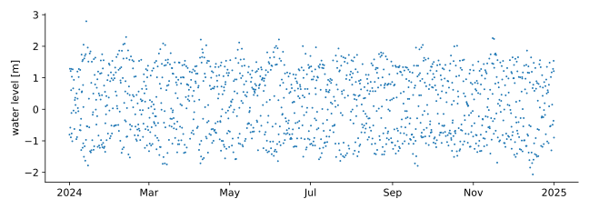
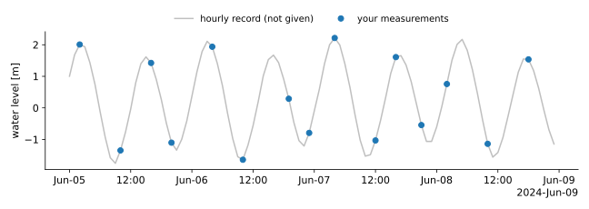
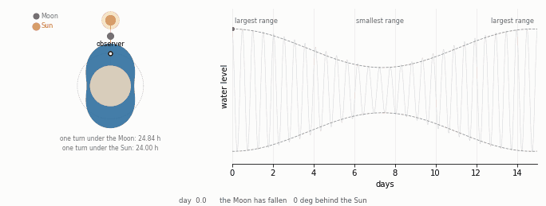
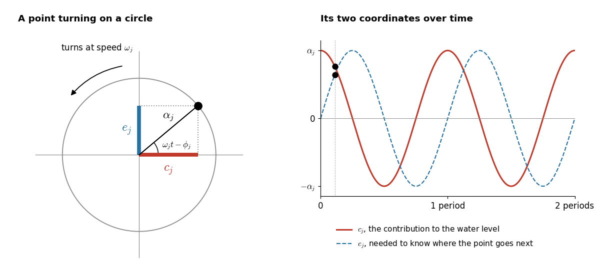

class: middle, center, title-slide

# Foundations of Data Science

Case study: Tides, storm surge and sea level

---

class: middle

.center.width-90[]
.center[The case study: one year of sea level in the harbour of Boston,  1443 measurements taken at random times, 3 to 9 hours apart.]

???

The data come from the NOAA tide gauge 8443970, in 2024. Each dot is one measurement, picked at random from the hourly record of the gauge. The file also gives the air pressure at the gauge, and the tide predicted by NOAA, which is kept aside for checks.

---

class: middle

.center.width-90[]
.center[Four days in June. The sea rises and falls by about 3 m twice a day,  but each tide is caught by one or two measurements only.]

???

The grey curve is the hourly record of the gauge. You do not get it, only the blue dots. The tide can no longer be read from a plot. It has to be found from all the measurements together, with a model.

---

class: middle

## What moves the sea

- .bold[The tide.] The Moon and the Sun raise the sea twice a day. The tide is a sum of sine waves, the .bold[constituents], whose periods are known from astronomy, for example 12 h 25 min for M2 (Moon) and 12 h for S2 (Sun). Their size and timing must be learned from the data.
- .bold[The surge.] The weather pushes the sea up, by about 1 cm for each hPa of pressure drop, plus the push of the wind. It builds up in a few hours, fades over a day or two, and never repeats.
- .bold[The slow level.] The average sea level changes over the year, and it has risen since the zero of the station was set.
- .bold[The fast movements.] Waves and water sloshing in the harbour look like noise.

.alert[The gauge measures only the sum. Nobody measures the tide or the surge alone.]

---

class: middle

.center.width-70[]
.center[M2 and S2 go in and out of step every 14.77 days:  large tides, then small tides.]

???

Two waves with close frequencies drift in and out of step, and their sum grows and shrinks. The distance of the Moon, which gives N2, and the tilt of its orbit, which gives K1 and O1, work the same way, with other periods.

---

class: middle

## Why this is a data science problem

Flood warnings need the surge, but the surge is never measured. It is hidden in a sum, together with the tide and the slow level.

The tide, the surge and the slow level are .bold[latent states] that change over time, and each measurement is their sum plus noise.

.success[This is a state-space model, as in Lecture 5. The Kalman filter and smoother separate the components, and say how sure they are about each one.]

???

The classical method, in use for more than a century, fits sine waves of fixed size by least squares and calls what is left the surge. It gives no uncertainty on the surge, and it cannot forecast it. The state-space model does both.

---

class: middle

## The model

.center.width-90[]

Each constituent is a point turning on a circle. Its horizontal coordinate $c\_j$ is its share of the water level. The state stacks all the components,
$$\mathbf{z}\_t = (c\_{1,t}, e\_{1,t}, \ldots, c\_{J,t}, e\_{J,t}, s\_t, \ell\_t),$$
with the surge $s\_t$ and the mean level $\ell\_t$.

???

The vertical coordinate $e\_j$ is not part of the water level, but it is needed to know whether $c\_j$ goes up or down next. The size and the timing of a constituent are the radius of the circle and the position of the point, so they do not need to be parameters: the filter estimates the position of the point.

---

class: middle

Between two measurements, $\Delta t$ hours apart, each point turns by $\omega\_j \Delta t$ and the surge relaxes towards zero, as the wolf of Lecture 5 returns home. Both are solved exactly,
$$p(\mathbf{z}\_t | \mathbf{z}\_{t-1}) = \mathcal{N}(\mathbf{z}\_t | \mathbf{A} \mathbf{z}\_{t-1}, \mathbf{Q}), \quad \text{with } \mathbf{A} \text{ and } \mathbf{Q} \text{ that depend on } \Delta t.$$

Each measurement adds the components, the effect of the air pressure and a noise,
$$x\_t | \mathbf{z}\_t \sim \mathcal{N}(\mathbf{H} \mathbf{z}\_t + \beta \tilde{p}\_t, \sigma\_x^2).$$

The parameters $\theta = (\kappa, \sigma\_s, \sigma\_\text{tide}, \sigma\_x, \beta)$ are estimated from the data.

???

$1/\kappa$ is the time a surge needs to fade, $\sigma\_s$ and $\sigma\_\text{tide}$ set how much the surge and the constituents move at random, $\sigma\_x$ is the noise of a measurement, and $\beta$ is the effect of one hPa of pressure. The notebook gives all the equations, in the Build section.

---

class: middle

## What you will do

.grid[
.kol-1-3[
.bold[Build]
- Q1. Explore the data
- Q2. Choose the constituents
- Q3. Write the model, and build $\mathbf{A}$, $\mathbf{Q}$, $\mathbf{H}$
- Q4. Choose a prior, and simulate
]
.kol-1-3[
.bold[Compute]
- Q5. Kalman filter
- Q6. Smoother, tested on simulated data
- Q7. Estimate $\theta$
- Q8. Separate tide, surge and slow level
]
.kol-1-3[
.bold[Critique]
- Q9. Check the model against the data
- Q10. Forecast the water level 48 h ahead
]
]

???

This is the Bayesian workflow of the course. Q6 matters most: on a simulated record you know the true surge, so you can check that your filter and smoother find it, before you trust them on the real data.

---

class: middle

## Practical

- .bold[Deadline.] December 18, 2026, on Gradescope.
- .bold[Notebook.] `project/case-study.ipynb`. Each point has a title cell, such as `### QUESTION 3.A`, and your answer goes below it. The notebook must run from top to bottom, and keep its outputs.
- .bold[Code.] `numpy`, `jax` or `pytorch`, as you prefer. Templates of the functions are given, and you may change them.
- .bold[AI assistants] are allowed. You must be able to explain every line and every choice.
- .bold[Evaluation.] A 30-minute oral discussion in January, separate from the theory exam. The case study counts for 40% of the final grade, and needs at least 8/20.

---

class: middle

## Tips

- Start from the wolf. Lecture 5 and `nb05` contain the filter, the smoother and the exact discretization that you need.
- Test the filter on simulated data (Q6) before you use it on the real record.
- Write the slow cells, the estimation and the simulations, so that you can run them again alone.
- Start early. Everything after Q5 depends on the filter.

---

class: end-slide, center
count: false

Questions?
