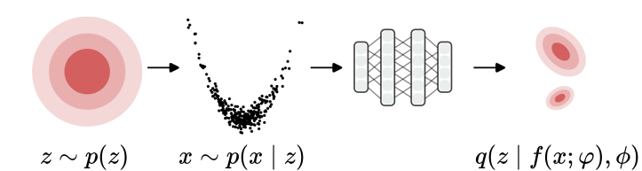

class: middle, center, title-slide

# Foundations of Data Science

Lecture 10: Simulation-based inference

  
Prof. Gilles Louppe 
[g.louppe@uliege.be](mailto:g.louppe@uliege.be)

---

class: middle

The parameters $\varphi$ of the inference model could be learned by maximizing the ELBO averaged over the dataset. 

However, because we want to amortize inference, we can rewrite the objective as the minimization of the expected forward KL divergence over the observations,
$$\varphi^* = \arg\min\_\varphi \mathbb{E}\_{p(x)} \left[ \text{KL}(p(z|x) || q(z | f(x; \varphi))) \right].$$

---

class: middle

While the forward KL divergence was previously inaccessible due to the lack of samples from the true posterior, in the amortized setting we can use samples from the joint distribution $p(z, x)$ to estimate the expected KL divergence!

$$\begin{aligned}
\mathbb{E}\_{p(x)} \left[ \text{KL}(p(z|x) || q(z | f(x; \varphi))) \right] &= \mathbb{E}\_{p(x)} \left[ \mathbb{E}\_{p(z|x)} \left[ \log \frac{p(z|x)}{q(z | f(x; \varphi))} \right] \right] \\\\
&= \mathbb{E}\_{p(x, z)} \left[ \log \frac{p(z|x)}{q(z | f(x; \varphi))} \right] \\\\
&= -\mathbb{E}\_{p(x, z)} \left[ \log q(z | f(x; \varphi)) \right] + \text{const}.
\end{aligned}$$

In other words, we can learn the inference model by maximizing the expected posterior log-density under the joint distribution! 

---

class: middle

## Neural posterior estimation (NPE)

Neural posterior estimation is an amortized variational inference method where the inference model is parameterized using neural networks.

.center.width-100[]

.footnote[Credits: Adapted from [Deistler et al](https://arxiv.org/abs/2508.12939), 2025.]

---

class: middle

The variational distribution can be defined in different ways, such as
- $q(z | f(x; \varphi))$, using a simple distribution (e.g., Gaussian) and a .bold[neural network]  $f(x; \varphi)$ that outputs the parameters of the variational distribution given an observation $x$,
- or as $q(z | f(x; \varphi); \phi)$ using a flexible density estimator, such as (conditional) .bold[normalizing flows], with parameters $\phi$, and a neural network $f(x; \varphi)$ that outputs a sufficient statistic of $x$.

---

class: middle

For training, we can generate samples from the joint distribution $p(z, x)$ by first sampling $z \sim p(z)$ from the prior and then sampling $x \sim p(x|z)$ from the likelihood.

The parameters $\varphi$ (and $\phi$ if applicable) can then be learned by maximizing the expected posterior log-density using stochastic gradient ascent,
$$\begin{aligned}
\varphi^\*, \phi^\* &= \arg\max\_{\varphi, \phi} \mathbb{E}\_{p(x, z)} \left[ \log q(z | f(x; \varphi); \phi) \right]. 
\end{aligned}$$

---

class: middle

.center.width-10[]

## Strengths and weaknesses

- NPE leverages neural networks to learn flexible inference models that can capture complex posterior distributions.
- NPE only requires samples from the joint distribution $p(z, x)$, making it applicable to a large class of models.
- NPE amortizes inference across multiple observations, making inference as fast as a forward pass through the neural network. However, this comes at the cost of an upfront training phase. 

---

class: middle

## Simulation-based inference

NPE is an example of simulation-based inference (SBI) methods, which are designed for scenarios where the likelihood $p(x|z)$ (resp. $p(x|\theta)$) is intractable but we can still generate samples from the joint distribution $p(z, x)$ (resp. $p(\theta, x)$) using a simulator.

SBI algorithms are a major evolution in Bayesian inference, enabling posterior inference in complex models where traditional methods fail, .bold[without simplifying assumptions].

---

class: middle

Alternative simulation-based inference algorithms include:
- Neural likelihood estimation (NLE): learns a surrogate likelihood model $q(x | \theta; \phi)$ using samples from $p(\theta, x)$, then performs inference using standard methods (e.g., MCMC, VI) with the surrogate likelihood.
- Neural ratio estimation (NRE): learns a likelihood-to-evidence ratio model $r(x, \theta; \phi) = \frac{p(x|\theta)}{p(x)}$ using samples from $p(\theta, x)$, then performs inference using standard methods with the learned ratio.
- Neural score estimation (NSE): learns a score function model $s(\theta | x; \phi) = \nabla_\theta \log p(\theta | x; \phi)$ using samples from $p(\theta, x)$, then performs inference using score-based methods.

These methods are not variational inference methods per se, but they share the same goal of approximating the posterior distribution in complex models.

---

class: end-slide, center
count: false

The end.
