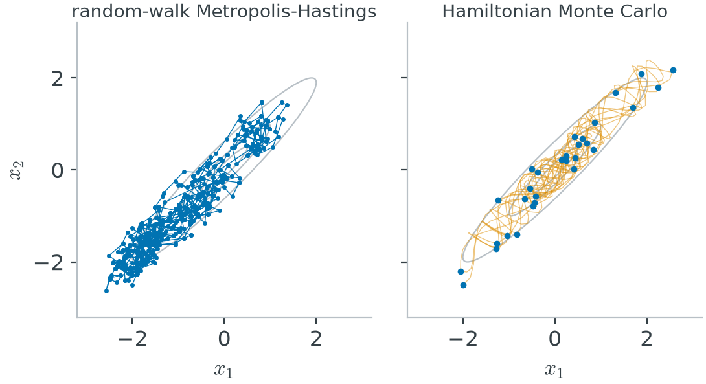

class: middle, center, title-slide

# Foundations of Data Science

Lecture 6: Markov chain Monte Carlo

  
Prof. Gilles Louppe 
[g.louppe@uliege.be](mailto:g.louppe@uliege.be)

---

class: middle

.center.width-10[]

How to sample from a distribution $p(x)$ for which we can only evaluate an unnormalized version $\tilde{p}(x)$ of its density?

Use cases:
- Generating data points $x$ from a generative model $p(x)$.
- Computing expectations $\mathbb{E}\_{p(x)}[f(x)]$ or integrals $\int f(x) p(x) dx$.
- Computing posterior distributions $p(\mathbf{z} \mid \mathbf{x})$ in Bayesian inference.

---

class: middle 

# Markov chain Monte Carlo

---

class: middle

.center.width-50[]

## Markov chains

A Markov chain is a sequence of random variables $X\_1, X\_2, \ldots$ that assumes the conditional independence of $X\_{t+1}$ and $X\_{1:t-1}$ given $X\_t$.

It follows that the joint distribution of $X\_1, \ldots, X\_T$ can be factorized as
$$p(x\_1, \ldots, x\_T) = p(x\_1) \prod\_{t=1}^{T-1} p(x\_{t+1} \mid x\_t),$$
where $p(x\_1)$ is the .bold[initial distribution] and $p(x\_{t+1} \mid x\_t)$ is the .bold[transition model].

???

The chain of states of the state-space models of Lecture 5, without the observations.

---

class: middle

When the transition model does not depend on $t$, i.e., $p(x\_{t+1} \mid x\_t) = p(x' \mid x)$ for all $t$, the Markov chain is said to be .bold[time-homogeneous].

---

class: middle

.center.width-70[]

.center[

.italic[Example 1.] Gaussian random walk with $p(x\_1) = \mathcal{N}(x\_1 | 0, 1)$ and transition model $p(x\_{t+1} \mid x\_t) = \mathcal{N}(x\_{t+1} | x\_t, \sigma^2)$.

]

---

class: middle

## Stationary distributions

A stationary distribution $\pi$ is a distribution that remains unchanged when passed through the transition model. 

Formally, $\pi(x)$ is stationary for the transition model $p(x' \mid x)$ if
$$\pi(x') = \int \pi(x) p(x' \mid x) dx.$$

Therefore, if $x\_t \sim \pi(x)$, then $x\_{t+1} \sim \pi(x)$.

---

class: middle

.center.width-70[]

.center[

.italic[Example 1, continued.] The Gaussian random walk does not have a stationary distribution since its variance increases indefinitely over time.

]

???

The marginal $p(x\_t)$ is Gaussian with mean 0 and variance $1 + (t-1)\sigma^2$.

---

class: middle

.center.width-70[]

.center[

.italic[Example 2.] Mean-reverting random walk with $p(x\_1) = \mathcal{N}(x\_1 | 0, 1)$ and transition model $p(x\_{t+1} \mid x\_t) = \mathcal{N}(x\_{t+1} | x\_t - \kappa(x\_t - \mu), \sigma^2)$.

]

???

This is the wolf model of Lecture 5 in one dimension, the Euler discretization of its Ornstein-Uhlenbeck process, here with $\kappa = 0.1$, $\sigma = 1$ and $\mu = 0$.

---

class: middle

.center.width-70[]

.center[

The mean-reverting random walk has the stationary distribution
$$\pi(x) = \mathcal{N}\left(x \Big| \mu, \frac{\sigma^2}{2\kappa - \kappa^2}\right).$$

]

???

If $x \sim \mathcal{N}(\mu, v)$, then $x' = x - \kappa (x - \mu) + \epsilon$ is Gaussian with mean $\mu$ and variance $(1 - \kappa)^2 v + \sigma^2$. Stationarity requires this variance to equal $v$, hence $v = \sigma^2 / (2\kappa - \kappa^2)$. With $\kappa = 0.1$ and $\sigma = 1$, $v = 5.26$.

---

class: middle

## Regularity conditions

A Markov chain is said to be:
- .bold[irreducible] if any state $x'$ can be reached from any state $x$, i.e., for any $x$, $x'$, there exists $t$ such that $p(x\_t = x' \mid x\_1 = x) > 0$.
- .bold[aperiodic] if there is no deterministic cycle, i.e., for all $x$, the greatest common divisor of the set $\\{t : p(x\_t = x \mid x\_1 = x) > 0\\}$ is 1.
- for discrete state spaces, .bold[positive recurrent] if the expected return time to any state is finite; for continuous state spaces, .bold[positive Harris recurrent] if the chain returns to any set $A$ with positive measure infinitely often with probability 1 and has a stationary distribution that integrates to one.

???

Irreducibility lets the chain reach every part of the state space. Aperiodicity rules out deterministic cycles. Recurrence keeps the chain from drifting away to infinity.

Recurrence alone is not enough. The Gaussian random walk of Example 1 is Harris recurrent: in one dimension, it returns to any interval infinitely often. Its only invariant measure is uniform over the real line, which does not integrate to one, so the walk has no stationary distribution. Positivity rules out this case.

---

class: middle

## Basic limit theorem for Markov chains

.italic[Theorem.] If a time-homogeneous Markov chain is irreducible, aperiodic, and positive (Harris) recurrent, then it satisfies the following properties:

- (Existence and uniqueness) There exists a .bold[unique] stationary distribution $\pi$;
- (Convergence) For any initial distribution $p(x\_1)$, $p(x\_t) \to \pi(x)$ as $t \to \infty$;
- (Ergodic theorem) For any function $f$ with $\mathbb{E}\_{\pi}[|f(x)|] < \infty$, $$\lim\_{T \to \infty} \frac{1}{T} \sum\_{t=1}^T f(x\_t) = \mathbb{E}\_{\pi}[f(x)]$$ almost surely.

.italic[Proof.] Beyond scope in the general case. The next slides prove it under a stronger condition.

???

Each condition has a role: irreducibility gives uniqueness, aperiodicity gives convergence, and positive recurrence gives a stationary distribution that integrates to one.

---

class: middle

## Doeblin condition

A Markov chain satisfies the .bold[Doeblin condition] if there exist $m \geq 1$, $\delta > 0$ and a distribution $\nu$ such that
$$p(x\_{t+m} \in A \mid x\_t = x) \geq \delta \nu(A)$$
for all states $x$ and sets $A$.

The $m$-step transition model then splits into
$$p(x\_{t+m} \mid x\_t) = \delta \nu(x\_{t+m}) + (1 - \delta) r(x\_{t+m} \mid x\_t),$$
where $r$ is another transition model. Every $m$ steps, the chain restarts from $\nu$ with probability $\delta$, whatever its current state.

???

The remainder $r = (p - \delta \nu) / (1 - \delta)$ is non-negative by the condition and integrates to one, so it is a transition model. The split can be read as a coin flip every $m$ steps: with probability $\delta$, draw the next state from $\nu$; otherwise, move with $r$. After a restart, the state no longer depends on $x\_1$.

A finite chain that is irreducible and aperiodic satisfies the condition: some power $P^m$ of its transition matrix has only positive entries, and $\delta = \sum\_y \min\_x P^m(x, y)$. So does an independence sampler whose ratio $\pi / q$ is bounded. Random-walk Metropolis-Hastings on an unbounded space does not: from far away, the chain needs more steps to come back. It still converges at a geometric rate, but the rate depends on the starting point, and the proof is beyond scope.

---

class: middle

.center.width-80[]

.center[

Two copies of a chain that restarts from $\nu = \mathcal{N}(0, 1)$ with probability $\delta = 0.05$ and otherwise takes a Gaussian random-walk step. Driven by the same random numbers, they coincide from the first restart on.

]

???

This chain satisfies the Doeblin condition with $m = 1$; the Gaussian random walk alone does not. The two copies stay 20 apart until the first restart, at $t = 21$, close to its mean $1 / \delta = 20$. From then on, they share their whole future: the chain has forgotten where it started.

The probability that no restart has happened by step $t$ is $(1 - \delta)^{t - 1}$. If the second copy starts from $\pi$, it stays distributed as $\pi$, and the first copy differs from it only on runs without a restart. This gives the bound of the next slide, by a second route.

---

class: middle

.italic[Theorem.] Under the Doeblin condition, there exists a unique stationary distribution $\pi$, and for any initial distribution $p(x\_1)$,
$$\\| p(x\_{t}) - \pi \\|\_\text{TV} \leq (1 - \delta)^{\lfloor (t-1)/m \rfloor},$$
where $\\| \mu - \mu' \\|\_\text{TV} = \sup\_A |\mu(A) - \mu'(A)|$ is the total variation distance.

.italic[Proof.] Write $\mu P^m$ and $\mu R$ for the distributions of $x\_{t+m}$ when $x\_t \sim \mu$, under $p$ and $r$. For two distributions $\mu$ and $\mu'$, the restart terms cancel:
$$\begin{aligned}
\mu P^m - \mu' P^m &= \delta \nu + (1 - \delta) \mu R - \delta \nu - (1 - \delta) \mu' R \\\\
&= (1 - \delta)(\mu R - \mu' R).
\end{aligned}$$
A transition model does not increase the total variation distance, hence
$$\\| \mu P^m - \mu' P^m \\|\_\text{TV} \leq (1 - \delta) \\| \mu - \mu' \\|\_\text{TV}.$$

???

$\mu R(A) - \mu' R(A) = \int r(A \mid x) (\mu - \mu')(dx)$, and $r(A \mid x)$ lies in $[0, 1]$, so this is at most $\sup\_A |\mu(A) - \mu'(A)|$.

Every $m$ steps, any two distributions get closer by a factor $1 - \delta$: $P^m$ is a contraction.

---

class: middle

The contraction gives the three results:

- (Uniqueness) Two stationary distributions $\pi$ and $\pi'$ satisfy
$$\\| \pi - \pi' \\|\_\text{TV} = \\| \pi P^m - \pi' P^m \\|\_\text{TV} \leq (1 - \delta) \\| \pi - \pi' \\|\_\text{TV},$$
hence $\pi = \pi'$.
- (Existence) The distributions $\mu P^{km}$ form a Cauchy sequence, since
$$\\| \mu P^{(k+1)m} - \mu P^{km} \\|\_\text{TV} \leq (1 - \delta)^k.$$
Their limit $\pi$ satisfies $\pi P^m = \pi$. Then $\pi P$ is also a fixed point of $P^m$, hence $\pi P = \pi$.
- (Convergence) Since the total variation distance is at most 1,
$$\\| p(x\_t) - \pi \\|\_\text{TV} = \\| p(x\_1) P^{t-1} - \pi P^{t-1} \\|\_\text{TV} \leq (1 - \delta)^{\lfloor (t-1)/m \rfloor}.$$

???

Existence is the Banach fixed-point theorem: the space of distributions with the total variation distance is complete, and a contraction on it has a unique fixed point.

---

class: middle

## What the theorem means

The chain .bold[forgets its initial state] at a geometric rate. After a warm-up of a few multiples of $m / \delta$ steps, $x\_t$ is distributed as $\pi$, whatever $x\_1$.

Two states of the chain also become independent as they get far apart. For a bounded $f$ and $x\_1 \sim \pi$,
$$|\text{Cov}(f(x\_s), f(x\_{s+k}))| \leq 2 \\|f\\|\_\infty^2 (1 - \delta)^{\lfloor k/m \rfloor},$$
and the variance of the average vanishes:
$$\mathbb{V}\left[\frac{1}{T} \sum\_{t=1}^T f(x\_t)\right] \approx \frac{\tau\_\text{int}}{T} \mathbb{V}\_\pi[f(x)] \to 0.$$
The average converges to $\mathbb{E}\_\pi[f(x)]$, as fast as for $T / \tau\_\text{int}$ independent samples.

???

The covariance bound: conditionally on $x\_s = x$, the distribution of $x\_{s+k}$ is $(1-\delta)^{\lfloor k/m \rfloor}$-close to $\pi$ in total variation, so $|\mathbb{E}[f(x\_{s+k}) \mid x\_s] - \mathbb{E}\_\pi[f]| \leq 2 \\|f\\|\_\infty (1-\delta)^{\lfloor k/m \rfloor}$. Under $\pi$, $\mathbb{E}[f(x\_{s+k}) \mid x\_s] - \mathbb{E}\_\pi[f]$ has mean zero, so the covariance is the expectation of its product with $f(x\_s)$, and $|f(x\_s)| \leq \\|f\\|\_\infty$.

Expanding the variance of the average gives $\frac{1}{T} \mathbb{V}\_\pi[f] (1 + 2 \sum\_{k \geq 1} (1 - k/T) \rho\_k)$, where $\rho\_k$ is the autocorrelation at lag $k$. The geometric decay makes the sum converge, to $\tau\_\text{int}$, the integrated autocorrelation time defined with the diagnostics. This is convergence in mean square, hence in probability; the almost sure convergence of the theorem needs more work.

Warm-up and effective sample size, used at the end of the lecture, are these two results put to work. In practice $\delta$ and $m$ are unknown, which is why convergence is checked with diagnostics.

---

class: middle

The theorem leaves two questions open: how to build a chain whose stationary distribution is a given target, and how fast the chain converges to it.

Detailed balance and Metropolis-Hastings answer the first. Diagnostics, at the end of the lecture, address the second.

---

class: middle 

.center.width-10[]

## Detailed balance

A transition model $p(x' \mid x)$ satisfies detailed balance with respect to a distribution $\pi$ if
$$\pi(x) p(x' \mid x) = \pi(x') p(x \mid x')$$
for all $x$, $x'$.

???

At equilibrium, with states distributed as $\pi$, the flow of probability from $x$ to $x'$ equals the flow from $x'$ to $x$.

---

class: middle

.italic[Proposition.] If a transition model $p(x' \mid x)$ satisfies detailed balance with respect to a distribution $\pi$, then $\pi$ is a stationary distribution of $p(x' \mid x)$.

.italic[Proof.] Integrating both sides of the detailed balance equation over $x$, we get
$$\begin{aligned}
\int \pi(x) p(x' \mid x) dx &= \int \pi(x') p(x \mid x') dx \\\\
&= \pi(x') \int p(x \mid x') dx \\\\
&= \pi(x').
\end{aligned}$$

---

class: middle

Detailed balance is a .bold[sufficient] condition for stationarity.

It is easier to check than stationarity itself, which makes it the tool of choice to construct a Markov chain with a given stationary distribution.

---

class: middle

## Metropolis-Hastings

The Metropolis-Hastings algorithm is a procedure for sampling from a target distribution $\pi(x)$, given only an unnormalized version $\tilde{\pi}(x)$ of its density.

The core idea is to construct a Markov chain whose stationary distribution matches the target distribution $\pi(x)$.

---

class: middle

The Metropolis-Hastings algorithm proceeds as follows:

1. Given the current state $x\_t$, propose a new state $x' \sim q(x' \mid x\_t)$ using a proposal distribution $q(x' \mid x\_t)$.
2. Compute the acceptance ratio
$$\alpha(x' \mid x\_t) = \min\\left(\frac{\tilde{\pi}(x') q(x\_t \mid x')}{\tilde{\pi}(x\_t) q(x' \mid x\_t)}, 1\right).$$
3. Accept the proposed state $x'$ with probability $\alpha(x' \mid x\_t)$. If accepted, set $x\_{t+1} = x'$. Otherwise, set $x\_{t+1} = x\_t$.
4. Repeat steps 1-3 for a large number of iterations.

This process generates a sequence of samples $x\_1, x\_2, \ldots$ that form a Markov chain.

---

class: middle

.italic[Proposition.] The Metropolis-Hastings algorithm constructs a Markov chain whose stationary distribution is $\pi(x)$.

.italic[Proof.] The transition model of the Markov chain is given by
$$p(x' \mid x) = \begin{cases}
q(x' \mid x) \alpha(x' \mid x) & \text{if } x' \neq x, \\\\
r(x) & \text{if } x' = x,
\end{cases}$$
where $r(x) = 1 - \int q(x' \mid x) \alpha(x' \mid x) dx'$ is the probability of rejecting the proposal and staying at the current state.

---

class: middle

To show that $\pi(x)$ is stationary, we verify the detailed balance condition for $x' \neq x$:
$$\begin{aligned}
\tilde{\pi}(x) p(x' \mid x) &= \tilde{\pi}(x) q(x' \mid x) \alpha(x' \mid x) \\\\
&= \tilde{\pi}(x) q(x' \mid x) \min\\left(\frac{\tilde{\pi}(x') q(x \mid x')}{\tilde{\pi}(x) q(x' \mid x)}, 1\right) \\\\
&= \min( \tilde{\pi}(x) q(x' \mid x), \tilde{\pi}(x') q(x \mid x') ) \\\\
&= \tilde{\pi}(x') q(x \mid x') \min\\left(\frac{\tilde{\pi}(x) q(x' \mid x)}{\tilde{\pi}(x') q(x \mid x')}, 1\right) \\\\
&= \tilde{\pi}(x') p(x \mid x').
\end{aligned}$$
Since $\pi(x) = \frac{\tilde{\pi}(x)}{Z}$ for some normalization constant $Z$, the detailed balance condition also holds for $\pi(x)$. Hence, $\pi(x)$ is a stationary distribution of the Markov chain.

For $x' = x$, detailed balance holds trivially.

---

class: middle

.italic[Proposition.] The Markov chain constructed by the Metropolis-Hastings algorithm satisfies the regularity conditions under appropriate conditions on $q$.

.italic[Sketch of proof.]
- Aperiodicity: The chain can stay at the same state when proposals are rejected, so $p(x|x) > 0$. This breaks any periodic cycles.

- Irreducibility: If the proposal $q$ has appropriate support, then for any $x, x'$ where $\pi(x), \pi(x') > 0$, there exists a sequence of proposals with positive probability connecting them.

- Recurrence: If $\pi$ is a proper probability distribution, the chain is positive Harris recurrent. (Proof beyond scope)

These conditions ensure convergence to $\pi(x)$ by the basic limit theorem.

???

It suffices that the proposal reaches every region where $\pi > 0$, possibly in several steps.

---

class: middle

## Proposal distributions

The efficiency of the Metropolis-Hastings algorithm heavily depends on the choice of the proposal distribution $q(x' \mid x)$.

Common choices include:
- .bold[Random walk]: $q(x' \mid x) = \mathcal{N}(x' | x, \sigma^2 I)$ for continuous state spaces. 
  Simple and general, but efficiency depends on tuning $\sigma$ 
  (optimal acceptance rate: about 44% in one dimension, 23% in high dimension).
  
- .bold[Langevin]: $q(x' \mid x) = \mathcal{N}(x' | x + \frac{\epsilon^2}{2} \nabla \log \tilde{\pi}(x), \epsilon^2 I)$, 
  which uses gradient information to guide proposals toward high-probability regions. 
  Requires differentiable $\tilde{\pi}(x)$.

- .bold[Independence]: $q(x' \mid x) = q(x')$, independent of current state.
  Can be efficient if $q(x')$ closely approximates $\pi(x)$.

???

The random walk is the most common choice, with $\sigma$ setting the step size. The Langevin proposal adds a step along the gradient of $\log \tilde{\pi}$, like gradient ascent with noise. The independence proposal works when a good approximation of $\pi$ is available, such as a Laplace approximation.

---

class: middle

## Hamiltonian Monte Carlo

Random-walk proposals explore the target by small, undirected steps. .bold[Hamiltonian Monte Carlo] (HMC) proposes distant states by following the gradient of $\log \tilde{\pi}$.

The state $x \in \mathbb{R}^d$ is augmented with a momentum $p \in \mathbb{R}^d$, and the chain targets the joint distribution
$$\pi(x, p) \propto \tilde{\pi}(x) \mathcal{N}(p | 0, I) \propto \exp(-H(x, p))$$
defined by the .bold[Hamiltonian]
$$H(x, p) = -\log \tilde{\pi}(x) + \frac{1}{2} p^T p.$$

???

Think of a ball rolling on the surface $-\log \tilde{\pi}(x)$: this is its potential energy, and $\frac{1}{2} p^T p$ is its kinetic energy. The marginal of $x$ under $\pi(x, p)$ is $\pi(x)$, so the momenta are discarded after sampling.

---

class: middle

## Hamiltonian dynamics

The Hamiltonian dynamics
$$\frac{dx}{ds} = \frac{\partial H}{\partial p} = p, \quad \frac{dp}{ds} = -\frac{\partial H}{\partial x} = \nabla \log \tilde{\pi}(x)$$
conserve $H$, preserve volume and are reversible. A proposal made by following them would be accepted with probability 1.

The dynamics are integrated numerically by the .bold[leapfrog] scheme, which repeats $L$ steps of size $\epsilon$:
$$\begin{aligned}
p &\leftarrow p + \frac{\epsilon}{2} \nabla \log \tilde{\pi}(x) \\\\
x &\leftarrow x + \epsilon p \\\\
p &\leftarrow p + \frac{\epsilon}{2} \nabla \log \tilde{\pi}(x).
\end{aligned}$$

???

The momentum accelerates the ball downhill, towards regions of high density, and carries it across them. Leapfrog preserves volume and is reversible, like the exact dynamics, but it conserves $H$ only approximately: the error grows with $\epsilon$.

---

class: middle

The HMC algorithm proceeds as follows:

1. Given the current state $x\_t$, draw a momentum $p \sim \mathcal{N}(0, I)$.
2. Starting from $(x\_t, p)$, run $L$ leapfrog steps of size $\epsilon$ to obtain $(x', p')$.
3. Accept $x\_{t+1} = x'$ with probability
$$\alpha = \min\left(1, \exp(H(x\_t, p) - H(x', p'))\right).$$
Otherwise, set $x\_{t+1} = x\_t$.

???

Step 3 is the Metropolis-Hastings acceptance for the joint target $\pi(x, p)$. The proposal is deterministic given $p$, reversible and volume preserving, so its densities cancel in the ratio. Only the integration error remains, and it corrects it exactly.

The step size $\epsilon$ controls the integration error, hence the acceptance rate. The number of steps $L$ controls how far the proposal travels. Too large an $\epsilon$ makes $H$ blow up and every proposal is rejected. With $L = 1$, HMC is the Langevin proposal of the previous slides with a Metropolis-Hastings correction.

---

class: middle

.center.width-80[]

.center[

Random-walk Metropolis-Hastings (600 iterations) and HMC (30 iterations of 20 leapfrog steps, in orange) on a correlated Gaussian, for the same number of evaluations of the target.

]

???

Each HMC iteration costs $L$ gradient evaluations, so the fair comparison is at equal cost. The random walk is still in the lower half of the target; HMC draws almost independent samples along the whole ellipse. The advantage grows with the dimension.

The gradients come from automatic differentiation: `nb06b` computes them with JAX.

---

class: middle

## Other samplers

- .bold[No-U-Turn Sampler (NUTS)]: An adaptive variant of HMC that automatically 
  tunes the trajectory length $L$.
  Default sampler in Stan and PyMC.

- .bold[Gibbs sampling]: Updates variables one at a time from conditional 
  distributions. A special case of MH with acceptance probability = 1 
  when conditionals are tractable.

---

class: middle, center

.center.width-10[]

Run the first part of `nb06b-mcmc.ipynb` to see Metropolis-Hastings in action.

---

class: middle

# Bayesian inference with MCMC

---

class: middle

## Bayesian inference with MCMC

In Bayesian inference, we are often interested in computing the posterior distribution $$p(\mathbf{z}, \theta \mid \mathbf{x}\_\text{obs}) = \frac{p(\mathbf{x}\_\text{obs} \mid \mathbf{z}, \theta) p(\mathbf{z}, \theta)}{p(\mathbf{x}\_\text{obs})}$$ of latent variables $\mathbf{z}$ and parameters $\theta$ given observed data $\mathbf{x}\_\text{obs}$.

.alert[In general, the normalizer $p(\mathbf{x}\_\text{obs}) = \int p(\mathbf{x}\_\text{obs} \mid \mathbf{z}, \theta) p(\mathbf{z}, \theta) d\mathbf{z} d\theta$ has no closed form.]

???

This is the posterior of Lecture 4, and its normalizer is the marginal likelihood. Lecture 5 left the posterior of the wolf's parameters to this lecture: the Kalman filter gives $p(\mathbf{x}\_{1:T} \mid \theta)$, and MCMC samples $p(\theta \mid \mathbf{x}\_{1:T}) \propto p(\mathbf{x}\_{1:T} \mid \theta) p(\theta)$.

---

class: middle

.center.width-10[]

MCMC methods, such as Metropolis-Hastings, generate samples from the posterior $p(\mathbf{z}, \theta \mid \mathbf{x}\_\text{obs})$ even when the normalizer $p(\mathbf{x}\_\text{obs})$ has no closed form.

Since MCMC methods only require an unnormalized density $\tilde{p}$, .bold[the joint density $p(\mathbf{x}\_\text{obs}, \mathbf{z}, \theta) = p(\mathbf{x}\_\text{obs} \mid \mathbf{z}, \theta) p(\mathbf{z}, \theta)$ can be used as the target], without the normalizer $p(\mathbf{x}\_\text{obs})$.

---

class: middle

.italic[Example 3.] Bayesian linear regression. Consider a data set $\mathcal{D} = \\{(x\_i, y\_i)\\}\_{i=1}^N$ of $N$ pairs of an input $x\_i \in \mathbb{R}$ and a target $y\_i \in \mathbb{R}$.
.center.width-70[]

---

class: middle

.center.width-50[]

We model $y$ given $x$ as a line with Gaussian noise, $$p(y \mid x, \mathbf{w}, \log \sigma) = \mathcal{N}(y \mid w\_0 x + w\_1, \sigma^2),$$ where $\mathbf{w} = (w\_0, w\_1)$ holds the slope and the intercept. The priors are $p(\mathbf{w}) = \mathcal{N}(\mathbf{w} \mid \mathbf{0}, \tau\_1^2 \mathbf{I})$ and $p(\log \sigma) = \mathcal{N}(\log \sigma \mid 0, \tau\_2^2)$, with hyperparameters $\tau\_1$ and $\tau\_2$.

---

class: middle

The target distribution is the posterior $p(\mathbf{w}, \log \sigma \mid \mathcal{D})$, which is proportional to the joint density
$$p(\mathbf{w}, \log \sigma \mid \mathcal{D}) \propto \left( \prod\_{i=1}^N p(y\_i \mid x\_i, \mathbf{w}, \log \sigma) \right) p(\mathbf{w}) p(\log \sigma).$$

We can use Metropolis-Hastings to sample from this posterior distribution using the joint density as the unnormalized target density.

---

class: middle

.center.width-70[]
.center[Traces of $w\_0$, $w\_1$ and $\log \sigma$ along the Markov chain of Metropolis-Hastings.]

---

class: middle

.center.width-60[]
.center[Posterior samples, after a warm-up of 1000 iterations.]

---

class: middle

.center.width-70[]
.center[Posterior predictive distribution $p(y \mid x, \mathcal{D})$: median and 5-95% band.]

---

class: middle

.center.width-10[]

## Diagnostics for MCMC

MCMC algorithms produce only approximate samples from the target distribution. It is important to assess the quality of these samples using diagnostics in terms of .bold[autocorrelation], .bold[mixing] and .bold[convergence].

---

class: middle

.bold[Trace plots] of the Markov chains can reveal mixing, autocorrelation, and convergence issues:

- High autocorrelation is indicated by chains that exhibit strong correlations between successive samples.
- Poor mixing is indicated by chains that explore the state space slowly or get stuck in certain regions.
- When running multiple chains, lack of convergence is indicated by chains that do not overlap or converge to the same distribution.

---

class: middle

.center.width-70[]
.center[High vs. low autocorrelation. For highly autocorrelated chains,   mixing is poor and effective sample size is low.]

---

class: middle

.center.width-70[]
.center[Poor vs. good mixing for a multimodal target. Poor mixing can be due to small proposal steps or energy barriers between modes.]

---

class: middle

.center.width-70[]
.center[Two chains run on the same target but initialized differently.   Traces show convergence to the same distribution.]

---

class: middle

## Acceptance rate

The first quantitative diagnostic to monitor is the .bold[acceptance rate], defined as the fraction of proposed samples that are accepted.

- A very low acceptance rate (e.g., < 10%) indicates that the proposal distribution is making too large jumps, leading to many rejections.
- A very high acceptance rate (e.g., > 80%) suggests that the proposal distribution is making too small jumps, resulting in slow exploration of the state space.
- For a Gaussian random-walk proposal, the optimal acceptance rate is about 44% in one dimension and decreases to 23.4% as the dimension grows.

???

Optimal means that the chain explores the target fastest, as measured by the effective sample size per iteration.

These values are derived for targets with independent components (Roberts, Gelman and Gilks, 1997), and they hold approximately beyond. The demos of `nb06b` sample one-dimensional targets, where 44% is the value to aim for.

---

class: middle

## Effective Sample Size

Quantitatively, the .bold[effective sample size] 
$$\text{ESS} = \frac{T}{1 + 2\sum\_{k=1}^{\infty} \rho\_k}$$ 
accounts for autocorrelation in MCMC samples, where $T$ is the number of samples in the chain and 
$$\rho\_k = \frac{\text{Cov}(X\_t, X\_{t+k})}{\text{Var}(X\_t)}$$ 
is the .bold[autocorrelation at lag $k$] computed over the samples.

A higher ESS indicates more independent samples and better mixing.

---

class: middle

## Integrated Autocorrelation Time

The .bold[integrated autocorrelation time] 
$$\tau\_{\text{int}} = 1 + 2\sum\_{k=1}^{\infty} \rho\_k$$ 
quantifies the number of correlated samples equivalent to one independent sample.

A smaller $\tau\_{\text{int}}$ indicates better mixing and more efficient sampling.

The effective sample size is therefore $\text{ESS} = T / \tau\_{\text{int}}$.

???

$\tau\_{\text{int}}$ is itself estimated from the chain, and the estimate is reliable only for chains much longer than $\tau\_{\text{int}}$. This is why `emcee` refuses to return it for chains shorter than 50 $\tau\_{\text{int}}$: the `AutocorrError` met in `nb01`.

---

class: middle

## Gelman-Rubin Statistic

The .bold[Gelman-Rubin statistic] $\hat{R}$ serves as a convergence diagnostic when running $M$ chains in parallel, each with $T$ samples (after burn-in). 
Let 
$$W = \frac{1}{M} \sum\_{m=1}^M s\_m^2$$ 
be the within-chain variance, where $s\_m^2$ is the sample variance of chain $m$, and 
$$B = \frac{T}{M-1} \sum\_{m=1}^M (\bar{x}\_m - \bar{x})^2$$ 
be the between-chain variance, where $\bar{x}\_m$ is the sample mean of chain $m$ and $\bar{x}$ is the overall mean across chains. 
Then, 
$$\hat{R} = \sqrt{\frac{\frac{T-1}{T} W + \frac{1}{T} B}{W}}.$$

---

class: middle

## Rank-normalized split-$\hat{R}$

In practice, $\hat{R}$ is computed with two modifications:
- each chain is split into two halves, which detects a chain that drifts during the run;
- each draw is replaced by the normal quantile of its rank among all draws, which makes $\hat{R}$ robust to heavy tails.

Values of $\hat{R}$ below 1.01 indicate convergence across chains.

The effective sample size is computed on the same rank-normalized draws (.bold[bulk ESS]) and on the indicators of the 5% and 95% quantiles (.bold[tail ESS]). Both should exceed 100 per chain.

???

These are the recommendations of Vehtari et al. (2021), used by Stan, ArviZ and PyMC. The older threshold of 1.1 lets non-converged chains through. Bulk ESS measures the precision of the mean and the median, tail ESS that of the 5% and 95% quantiles.

$\hat{R}$ needs independent chains started from dispersed points. The walkers of `emcee` are not independent chains: they move using each other's positions. `nb06b` computes $\hat{R}$ on independent runs of Metropolis-Hastings.

---

class: middle

## Calibration

Diagnostics check that the chains have converged. They do not check that they converged to the right posterior: a bug in the log density goes unnoticed.

Let $\theta^\* \sim p(\theta)$ and $\mathcal{D} \sim p(\mathcal{D} \mid \theta^\*)$. The exact posterior is .bold[calibrated]: a credible region $C\_\alpha(\mathcal{D})$ of level $\alpha$ contains $\theta^\*$ with probability $\alpha$,
$$P(\theta^\* \in C\_\alpha(\mathcal{D})) = \alpha.$$

???

The pair $(\theta^\*, \mathcal{D})$ is drawn from the joint $p(\theta, \mathcal{D})$, so given $\mathcal{D}$, $\theta^\*$ is distributed as the posterior $p(\theta \mid \mathcal{D})$. The probability is over both $\theta^\*$ and $\mathcal{D}$: calibration holds on average over data sets, not for each of them.

A buggy or unconverged sampler breaks calibration. Overconfident regions are too narrow and contain $\theta^\*$ less often than $\alpha$.

---

class: middle

## Simulation-based calibration

For $s = 1, \ldots, S$:
1. Draw $\theta^\*\_s \sim p(\theta)$ and $\mathcal{D}\_s \sim p(\mathcal{D} \mid \theta^\*\_s)$.
2. Draw $L$ samples $\theta\_1, \ldots, \theta\_L$ with the sampler targeting $p(\theta \mid \mathcal{D}\_s)$.
3. Compute the rank $r\_s = \sum\_{l=1}^L 1[\theta\_l < \theta^\*\_s] \in \\{0, \ldots, L\\}$.

.italic[Proposition.] If the sampler draws independent samples from the exact posterior, the ranks $r\_s$ are uniformly distributed over $\\{0, \ldots, L\\}$.

.italic[Proof.] Given $\mathcal{D}\_s$, $\theta^\*\_s, \theta\_1, \ldots, \theta\_L$ are $L + 1$ independent draws from $p(\theta \mid \mathcal{D}\_s)$. By symmetry, $\theta^\*\_s$ takes any of the $L + 1$ positions in their sorted order with the same probability.

???

For several parameters, ranks are computed for each parameter separately, or for any function of the parameters.

The draws must be nearly independent: MCMC samples are thinned by more than $\tau\_{\text{int}}$, otherwise autocorrelation alone makes the histogram non-uniform. Each simulation runs a full MCMC, so SBC is expensive. The method is due to Talts et al. (2018).

---

class: middle

.center.width-80[]

.center[

Rank histograms of simulation-based calibration for the Bayesian linear regression, with $S = 1000$ simulations and $L = 99$ draws of random-walk Metropolis-Hastings each. The grey band holds 99% of the counts of uniform ranks.

]

???

The correct sampler gives flat histograms. The bug uses the variance where scipy expects the standard deviation, `norm.logpdf(y, mu, sigma**2)`. The slope and the intercept are still calibrated, but the posterior of $\log \sigma$ sits away from $\theta^\*$: the ranks pile up at both ends.

Other shapes are typical. A U shape means an overconfident posterior, a hump an underconfident one, a slope a biased one.

The chains start at the least-squares fit, adapt their proposal during the warm-up only, and keep one draw in 100.

---

class: end-slide, center
count: false

The end.
