class: middle, center, title-slide

# Foundations of Data Science

Lecture 6: Markov chain Monte Carlo

  
Prof. Gilles Louppe 
[g.louppe@uliege.be](mailto:g.louppe@uliege.be)

---

class: middle

.center.width-55[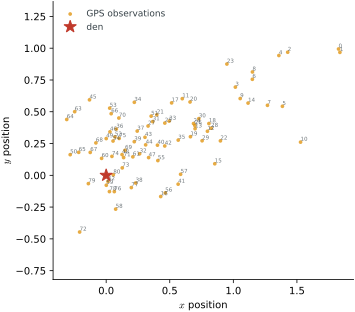]

.question[

The normalizing constants of the Kalman filter updates multiply into the likelihood $p(\mathbf{x}\_{1:T} \mid \theta)$ of the parameters $\theta$ of the wolf model. How do we obtain their posterior $p(\theta \mid \mathbf{x}\_{1:T})$?

]

---

class: middle

.center.width-10[]

More generally, how to sample from a distribution $p(x)$ when only an unnormalized version $\tilde{p}(x)$ of its density can be evaluated?

Use cases:
- Generating data points $x$ from a generative model $p(x)$.
- Computing expectations $\mathbb{E}\_{p(x)}[f(x)]$ or integrals $\int f(x) p(x) dx$.
- Computing posterior distributions $p(\mathbf{z} \mid \mathbf{x})$ in Bayesian inference.

---

class: middle 

# Markov chain Monte Carlo

---

class: middle

.center.width-50[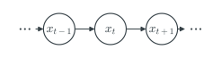]

## Markov chains

A Markov chain is a sequence of random variables $X\_1, X\_2, \ldots$ that assumes the conditional independence of $X\_{t+1}$ and $X\_{1:t-1}$ given $X\_t$.

It follows that the joint distribution of $X\_1, \ldots, X\_T$ can be factorized as
$$p(x\_1, \ldots, x\_T) = p(x\_1) \prod\_{t=1}^{T-1} p(x\_{t+1} \mid x\_t),$$
where $p(x\_1)$ is the .bold[initial distribution] and $p(x\_{t+1} \mid x\_t)$ is the .bold[transition model].

---

class: middle

When the transition model does not depend on $t$, i.e., $p(x\_{t+1} \mid x\_t) = p(x' \mid x)$ for all $t$, the Markov chain is said to be .bold[time-homogeneous].

---

class: middle

.center.width-70[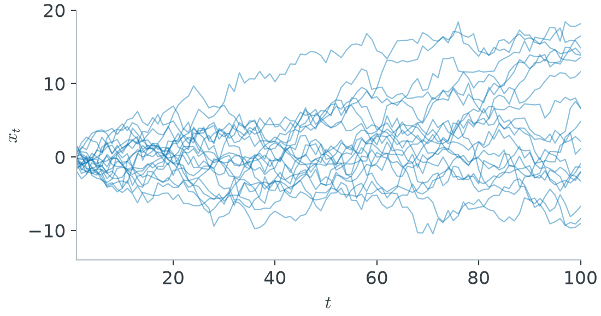]

.center[

.italic[Example 1.] Gaussian random walk with $p(x\_1) = \mathcal{N}(x\_1 \mid 0, 1)$ and transition model $p(x\_{t+1} \mid x\_t) = \mathcal{N}(x\_{t+1} \mid x\_t, \sigma^2)$.

]

---

class: middle

## Stationary distributions

A stationary distribution $\pi$ is a distribution that remains unchanged when passed through the transition model. 

Formally, $\pi(x)$ is stationary for the transition model $p(x' \mid x)$ if
$$\pi(x') = \int \pi(x) p(x' \mid x) dx.$$

Therefore, if $x\_t \sim \pi(x)$, then $x\_{t+1} \sim \pi(x)$.

---

class: middle

.center.width-70[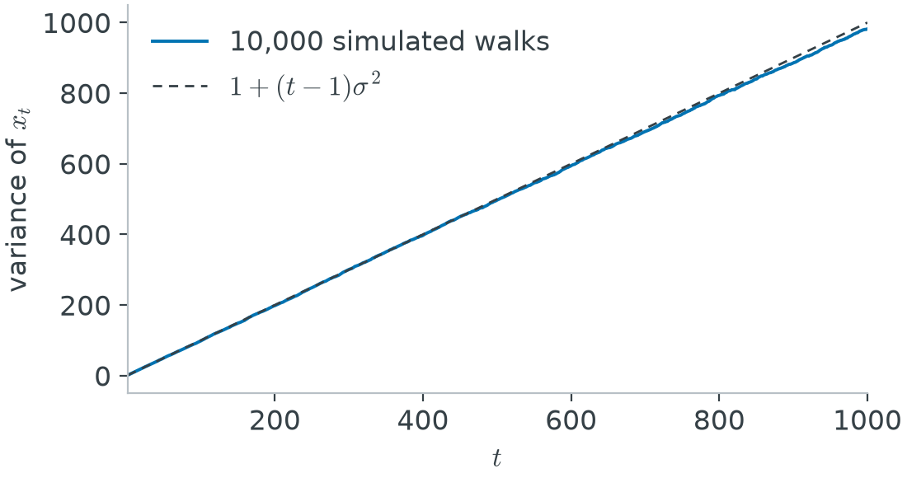]

.center[

.italic[Example 1, continued.] The Gaussian random walk does not have a stationary distribution since its variance increases indefinitely over time.

]

---

class: middle

.center.width-70[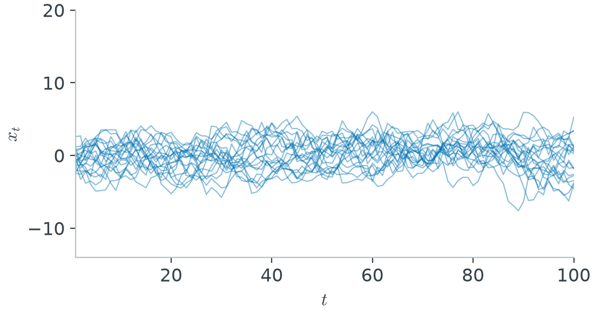]

.center[

.italic[Example 2.] Mean-reverting random walk with $p(x\_1) = \mathcal{N}(x\_1 \mid 0, 1)$ and transition model $p(x\_{t+1} \mid x\_t) = \mathcal{N}(x\_{t+1} \mid x\_t - \kappa(x\_t - \mu), \sigma^2)$.

]

---

class: middle

.center.width-70[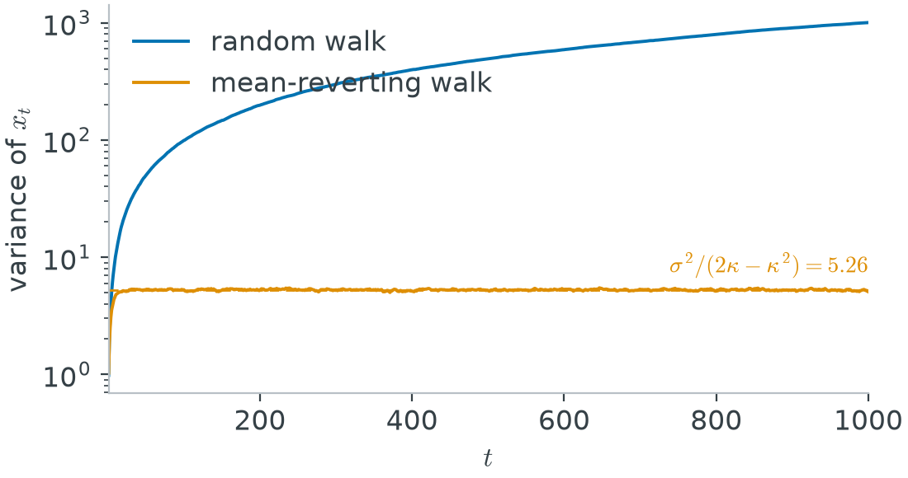]

.center[

For $0 < \kappa < 2$, the mean-reverting random walk has the stationary distribution
$$\pi(x) = \mathcal{N}\left(x \,\middle|\, \mu, \frac{\sigma^2}{2\kappa - \kappa^2}\right).$$

]

---

class: middle

## Regularity conditions

Let $\nu$ be a distribution on the state space, such as $\mathcal{N}(0, 1)$ on the real line. A set $A$ has positive measure if its probability $\nu(A)$ under $\nu$ is positive. A Markov chain is said to be:
- .bold[irreducible] if any set $A$ with positive measure $\nu(A) > 0$ can be reached from any state $x$, i.e., there exists $t$ such that $p(x\_t \in A \mid x\_1 = x) > 0$.
- .bold[aperiodic] if there is no deterministic cycle, i.e., the state space cannot be split into $d \geq 2$ disjoint sets that the chain visits in turn. For discrete state spaces, the possible return times $\\{t \geq 1 : p(x\_{1+t} = x \mid x\_1 = x) > 0\\}$ have greatest common divisor 1 for all $x$.
- .bold[Harris recurrent] if, from any state, the chain returns to any set $A$ with positive measure $\nu(A) > 0$ infinitely often with probability 1.

---

class: middle

## Basic limit theorem for Markov chains

.italic[Theorem.] If a time-homogeneous Markov chain has a stationary distribution $\pi$ and is irreducible and aperiodic, then:

- (Uniqueness) $\pi$ is its .bold[only] stationary distribution;
- (Convergence) For almost any initial state $x\_1$, $p(x\_t) \to \pi(x)$ as $t \to \infty$, and for every $x\_1$ if the chain is Harris recurrent;
- (Ergodic theorem) For any function $f$ with $\mathbb{E}\_{\pi}[|f(x)|] < \infty$, $$\lim\_{T \to \infty} \frac{1}{T} \sum\_{t=1}^T f(x\_t) = \mathbb{E}\_{\pi}[f(x)]$$ almost surely.

.italic[Proof.] Beyond scope in the general case. The next slides prove it under a stronger condition.

.footnote[Credits: [Meyn and Tweedie](https://doi.org/10.1017/CBO9780511626630), Markov Chains and Stochastic Stability, 2009; [Tierney](https://doi.org/10.1214/aos/1176325750), 1994.]

---

class: middle

## Doeblin condition

A Markov chain satisfies the .bold[Doeblin condition] if there exist $m \geq 1$, $0 < \delta < 1$ and a distribution $\nu$ such that
$$p(x\_{t+m} \in A \mid x\_t = x) \geq \delta \nu(A)$$
for all states $x$ and sets $A$.

Wherever the chain is, the distribution of its state $m$ steps later contains a .bold[common part] $\delta \nu$. A fraction $\delta$ of the probability goes to the same places, whatever the current state.

---

class: middle

.center.width-80[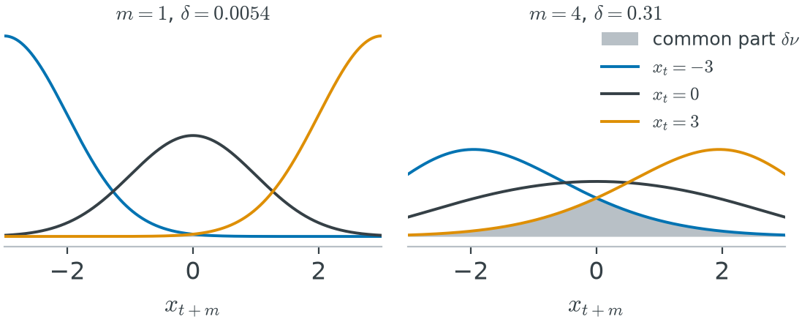]

.center[

Top: densities of $x\_{t+m}$ given $x\_t = -3, \ldots, 3$, for a random walk on $[-3, 3]$.  All lie above the shaded common part $\delta \nu$, of area $\delta$, as the condition requires.  Bottom: $\nu$, the common part rescaled to area 1.

]

---

class: middle

Remove the common part from the $m$-step transition model and rescale what remains:
$$\bar{p}(x\_{t+m} \mid x\_t) = \frac{p(x\_{t+m} \mid x\_t) - \delta \nu(x\_{t+m})}{1 - \delta}.$$
By the Doeblin condition, $\bar{p}$ is non-negative. It integrates to $\frac{1 - \delta}{1 - \delta} = 1$, since $p$ and $\nu$ both integrate to 1. So $\bar{p}$ is a transition model, and
$$p(x\_{t+m} \mid x\_t) = \delta \nu(x\_{t+m}) + (1 - \delta) \bar{p}(x\_{t+m} \mid x\_t).$$

The $m$-step transition is a mixture. Every $m$ steps, the chain draws its next state from $\nu$ with probability $\delta$, whatever its current state, and moves with $\bar{p}$ otherwise.

A draw from $\nu$ is a .bold[restart]: the new state does not depend on the current one.

---

class: middle

.italic[Example.] The chain
$$p(x' \mid x) = \delta \nu(x') + (1 - \delta) \mathcal{N}(x' \mid x, 1),$$
with $\nu = \mathcal{N}(0, 1)$ and $\delta = 0.05$, satisfies the Doeblin condition with $m = 1$.

We simulate two copies of this chain from $x\_1 = -10$ and $x\_1 = 10$, with the same random numbers.

.center.width-80[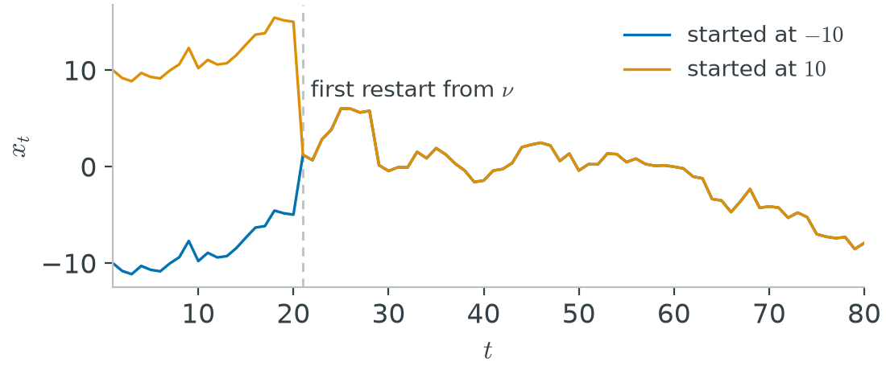]

.center[

The two copies coincide from the first restart on.

]

---

class: middle

.italic[Theorem.] Under the Doeblin condition, there is a unique stationary distribution $\pi$. For any $p(x\_1)$,
$$\\| p(x\_{t}) - \pi \\|\_\text{TV} \leq (1 - \delta)^{\lfloor (t-1)/m \rfloor},$$
the probability of no restart in $t - 1$ steps, as in the example. The total variation distance is $\\| p\_1 - p\_1' \\|\_\text{TV} = \sup\_A |p\_1(A) - p\_1'(A)|$.

.italic[Proof.] Let $p\_1 P^n$ be the distribution of $x\_{t+n}$ when $x\_t \sim p\_1$, and $p\_1 \bar{P}$ likewise for one move of $\bar{p}$. The terms in $\delta \nu$ cancel:
$$p\_1 P^m - p\_1' P^m = (1 - \delta)(p\_1 \bar{P} - p\_1' \bar{P}).$$
Since $\bar{p}$ does not increase the total variation distance,
$$\\| p\_1 P^m - p\_1' P^m \\|\_\text{TV} \leq (1 - \delta) \\| p\_1 - p\_1' \\|\_\text{TV}.$$

---

class: middle

Every $m$ steps, any two distributions get closer by a factor $1 - \delta$. With this notation, a distribution $\pi$ is stationary if and only if $\pi P = \pi$. The three results follow:

- (Uniqueness) Two stationary distributions $\pi$ and $\pi'$ satisfy $\pi P^m = \pi$ and $\pi' P^m = \pi'$, so
$$\\| \pi - \pi' \\|\_\text{TV} = \\| \pi P^m - \pi' P^m \\|\_\text{TV} \leq (1 - \delta) \\| \pi - \pi' \\|\_\text{TV},$$
hence $\pi = \pi'$.
- (Existence) The distributions $p\_1 P^{km}$ get closer and closer to each other,
$$\\| p\_1 P^{(k+1)m} - p\_1 P^{km} \\|\_\text{TV} \leq (1 - \delta)^k.$$
so they converge to a limit $\pi$, with $\pi P^m = \pi$. Then $(\pi P) P^m = (\pi P^m) P = \pi P$, so $\pi P$ is also unchanged by $P^m$, and $\pi P = \pi$ by uniqueness.
- (Convergence) Applying the inequality $\lfloor (t-1)/m \rfloor$ times, and since the total variation distance is at most 1,
$$\\| p(x\_t) - \pi \\|\_\text{TV} = \\| p(x\_1) P^{t-1} - \pi P^{t-1} \\|\_\text{TV} \leq (1 - \delta)^{\lfloor (t-1)/m \rfloor}.$$

---

class: middle

The first states of a chain still depend on $x\_1$. They are discarded as a .bold[warm-up].

Two questions remain: how to build a chain whose stationary distribution is a given target, and how long to run it when $m$ and $\delta$ are unknown.

Detailed balance and Metropolis-Hastings answer the first. Diagnostics, at the end of the lecture, address the second.

---

class: middle 

.center.width-10[]

## Detailed balance

A transition model $p(x' \mid x)$ satisfies detailed balance with respect to a distribution $\pi$ if
$$\pi(x) p(x' \mid x) = \pi(x') p(x \mid x')$$
for all $x$, $x'$.

---

class: middle

.italic[Proposition.] If a transition model $p(x' \mid x)$ satisfies detailed balance with respect to a distribution $\pi$, then $\pi$ is a stationary distribution of $p(x' \mid x)$.

.italic[Proof.] Integrating both sides of the detailed balance equation over $x$, we get
$$\begin{aligned}
\int \pi(x) p(x' \mid x) dx &= \int \pi(x') p(x \mid x') dx \\\\
&= \pi(x') \int p(x \mid x') dx \\\\
&= \pi(x').
\end{aligned}$$

---

class: middle

Detailed balance is a .bold[sufficient] condition for stationarity.

It is easier to check than stationarity itself, which makes it the tool of choice to construct a Markov chain with a given stationary distribution.

---

class: middle

## Metropolis-Hastings

The Metropolis-Hastings algorithm is a procedure for sampling from a target distribution $\pi(x)$, given only an unnormalized version $\tilde{\pi}(x)$ of its density.

The core idea is to construct a Markov chain whose stationary distribution matches the target distribution $\pi(x)$.

---

class: middle

The Metropolis-Hastings algorithm proceeds as follows:

1. Given the current state $x\_t$, propose a new state $x' \sim q(x' \mid x\_t)$ using a proposal distribution $q(x' \mid x\_t)$.
2. Compute the acceptance ratio
$$\alpha(x' \mid x\_t) = \min\\left(\frac{\tilde{\pi}(x') q(x\_t \mid x')}{\tilde{\pi}(x\_t) q(x' \mid x\_t)}, 1\right).$$
3. Accept the proposed state $x'$ with probability $\alpha(x' \mid x\_t)$. If accepted, set $x\_{t+1} = x'$. Otherwise, set $x\_{t+1} = x\_t$.
4. Repeat steps 1-3 for a large number of iterations.

This process generates a sequence of samples $x\_1, x\_2, \ldots$ that form a Markov chain.

.footnote[Credits: [Metropolis et al.](https://doi.org/10.1063/1.1699114), 1953; [Hastings](https://doi.org/10.1093/biomet/57.1.97), 1970.]

---

class: middle

.center.width-60[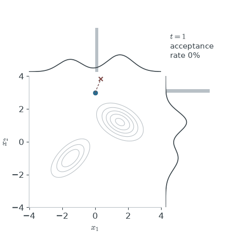]

.center[

Metropolis-Hastings on a mixture of two Gaussians, with the random-walk proposal $q(\mathbf{x}' \mid \mathbf{x}) = \mathcal{N}(\mathbf{x}' \mid \mathbf{x}, \sigma^2 \mathbf{I})$. Proposals are accepted (green) or rejected (red), and the histograms of the chain approach the marginals of the target.

]

---

class: middle

.center.width-80[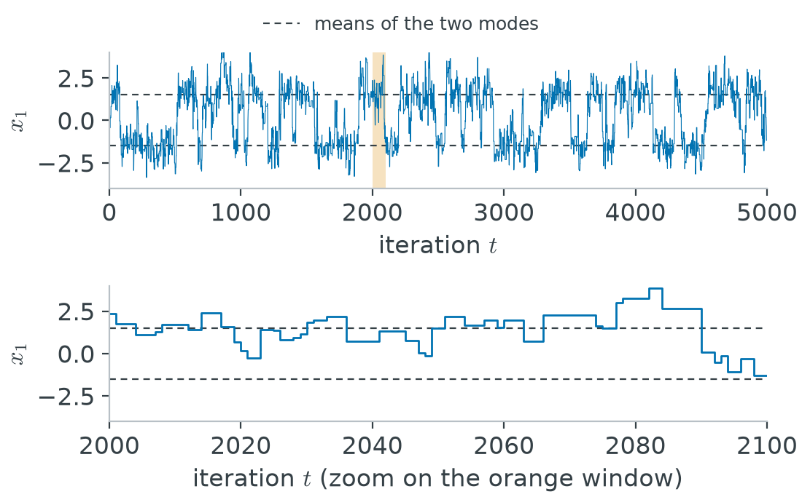]

.center[

Traces of $x\_1$ and $x\_2$ along the same Markov chain of Metropolis-Hastings.

]

---

class: middle

.italic[Proposition.] The Metropolis-Hastings algorithm constructs a Markov chain whose stationary distribution is $\pi(x)$.

.italic[Proof.] The transition model of the Markov chain is given by
$$p(x' \mid x) = \begin{cases}
q(x' \mid x) \alpha(x' \mid x) & \text{if } x' \neq x, \\\\
r(x) & \text{if } x' = x,
\end{cases}$$
where $r(x) = 1 - \int q(x' \mid x) \alpha(x' \mid x) dx'$ is the probability of rejecting the proposal and staying at the current state.

---

class: middle

For $x' \neq x$, the chain satisfies detailed balance with respect to $\pi$:
$$\begin{aligned}
\tilde{\pi}(x) p(x' \mid x) &= \tilde{\pi}(x) q(x' \mid x) \alpha(x' \mid x) \\\\
&= \tilde{\pi}(x) q(x' \mid x) \min\\left(\frac{\tilde{\pi}(x') q(x \mid x')}{\tilde{\pi}(x) q(x' \mid x)}, 1\right) \\\\
&= \min( \tilde{\pi}(x) q(x' \mid x), \tilde{\pi}(x') q(x \mid x') ) \\\\
&= \tilde{\pi}(x') q(x \mid x') \min\\left(\frac{\tilde{\pi}(x) q(x' \mid x)}{\tilde{\pi}(x') q(x \mid x')}, 1\right) \\\\
&= \tilde{\pi}(x') p(x \mid x').
\end{aligned}$$
Since $\pi(x) = \frac{\tilde{\pi}(x)}{Z}$ for some normalization constant $Z$, the detailed balance condition also holds for $\pi(x)$. By the proposition on detailed balance, $\pi(x)$ is a stationary distribution of the Markov chain.

For $x' = x$, detailed balance holds trivially.

---

class: middle

.italic[Proposition.] Under appropriate conditions on $q$, the Markov chain constructed by the Metropolis-Hastings algorithm satisfies the conditions of the basic limit theorem.

.italic[Sketch of proof.]
- Stationarity: $\pi$ is a stationary distribution, by the previous proposition.

- Aperiodicity: The chain stays at the same state when a proposal is rejected, which happens with probability $r(x) > 0$. This breaks any periodic cycles.

- Irreducibility: If the proposal $q$ has appropriate support, then for any $x, x'$ where $\pi(x), \pi(x') > 0$, there exists a sequence of proposals with positive probability connecting them.

- Harris recurrence: An irreducible Metropolis-Hastings chain is Harris recurrent. (Proof beyond scope)

By the basic limit theorem, the chain converges to $\pi$ from every initial state.

---

class: middle

## Hamiltonian Monte Carlo

The traces show that random-walk proposals explore the target by small, undirected steps. .bold[Hamiltonian Monte Carlo] (HMC) proposes distant states by following the gradient of $\log \tilde{\pi}$.

The state $\mathbf{x} \in \mathbb{R}^d$ is augmented with a momentum $\mathbf{v} \in \mathbb{R}^d$, and the chain targets the joint distribution
$$\pi(\mathbf{x}, \mathbf{v}) \propto \tilde{\pi}(\mathbf{x}) \mathcal{N}(\mathbf{v} \mid \mathbf{0}, \mathbf{I}) \propto \exp(-H(\mathbf{x}, \mathbf{v}))$$
defined by the .bold[Hamiltonian]
$$H(\mathbf{x}, \mathbf{v}) = -\log \tilde{\pi}(\mathbf{x}) + \frac{1}{2} \mathbf{v}^T \mathbf{v}.$$

.footnote[Credits: [Duane et al.](https://doi.org/10.1016/0370-2693%2887%2991197-X), 1987; [Neal](https://arxiv.org/abs/1206.1901), 2011.]

---

class: middle

## Hamiltonian dynamics

The Hamiltonian dynamics move $(\mathbf{x}, \mathbf{v})$ along a fictitious time $s$,
$$\frac{d\mathbf{x}}{ds} = \frac{\partial H}{\partial \mathbf{v}} = \mathbf{v}, \quad \frac{d\mathbf{v}}{ds} = -\frac{\partial H}{\partial \mathbf{x}} = \nabla \log \tilde{\pi}(\mathbf{x}).$$
Following them keeps $H$ constant, and leaves $\pi(\mathbf{x}, \mathbf{v})$ stationary.

The dynamics are integrated numerically by the .bold[leapfrog] scheme, which repeats $L$ steps of size $\epsilon$:
$$\begin{aligned}
\mathbf{v} &\leftarrow \mathbf{v} + \frac{\epsilon}{2} \nabla \log \tilde{\pi}(\mathbf{x}) \\\\
\mathbf{x} &\leftarrow \mathbf{x} + \epsilon \mathbf{v} \\\\
\mathbf{v} &\leftarrow \mathbf{v} + \frac{\epsilon}{2} \nabla \log \tilde{\pi}(\mathbf{x}).
\end{aligned}$$

---

class: middle

The HMC algorithm proceeds as follows:

1. Given the current state $\mathbf{x}\_t$, draw a momentum $\mathbf{v} \sim \mathcal{N}(\mathbf{0}, \mathbf{I})$.
2. Starting from $(\mathbf{x}\_t, \mathbf{v})$, run $L$ leapfrog steps of size $\epsilon$ to obtain $(\mathbf{x}', \mathbf{v}')$.
3. Accept $\mathbf{x}\_{t+1} = \mathbf{x}'$ with probability
$$\alpha = \min\left(1, \exp(H(\mathbf{x}\_t, \mathbf{v}) - H(\mathbf{x}', \mathbf{v}'))\right).$$
Otherwise, set $\mathbf{x}\_{t+1} = \mathbf{x}\_t$.

Step 3 is the Metropolis-Hastings acceptance for the target $\pi(\mathbf{x}, \mathbf{v})$, with a proposal whose densities cancel in the ratio.

---

class: middle

.center.width-100[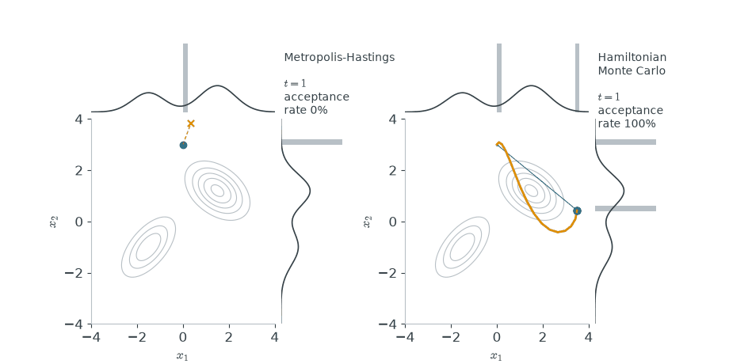]

.center[

Metropolis-Hastings and HMC on the same target, from the same starting point.  Each HMC iteration follows a leapfrog trajectory (orange).

]

---

class: middle

.center.width-80[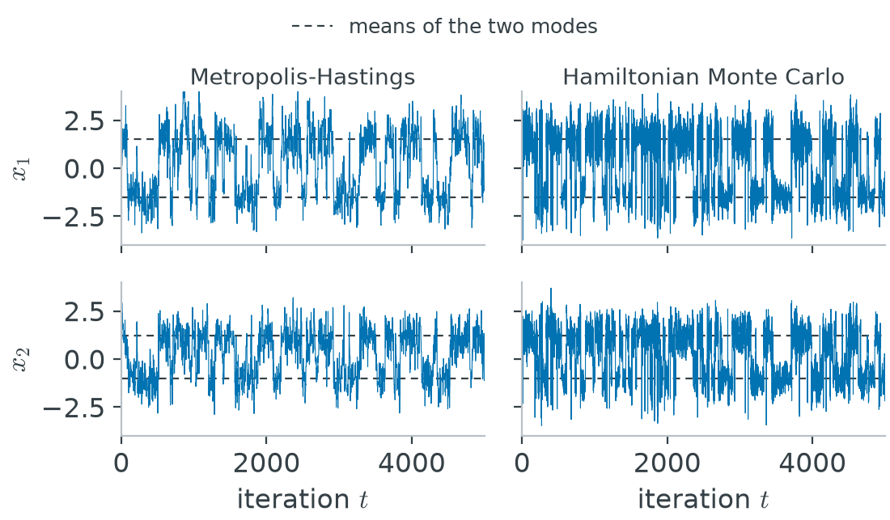]

.center[

Traces of $x\_1$ and $x\_2$ for Metropolis-Hastings and HMC.

]

---

class: middle, center

.center.width-10[]

Run the first part of `nb06b-mcmc.ipynb` to see Metropolis-Hastings in action.

---

class: middle

# Bayesian inference with MCMC

---

class: middle

## Bayesian inference with MCMC

In Bayesian inference, we are often interested in computing the posterior distribution $$p(\mathbf{z}, \theta \mid \mathbf{x}\_\text{obs}) = \frac{p(\mathbf{x}\_\text{obs} \mid \mathbf{z}, \theta) p(\mathbf{z}, \theta)}{p(\mathbf{x}\_\text{obs})}$$ of latent variables $\mathbf{z}$ and parameters $\theta$ given observed data $\mathbf{x}\_\text{obs}$.

In general, the normalizer
$$p(\mathbf{x}\_\text{obs}) = \int p(\mathbf{x}\_\text{obs} \mid \mathbf{z}, \theta) p(\mathbf{z}, \theta) d\mathbf{z} d\theta$$
has no closed form.

---

class: middle

.center.width-10[]

MCMC methods, such as Metropolis-Hastings, generate samples from the posterior $p(\mathbf{z}, \theta \mid \mathbf{x}\_\text{obs})$ even when the normalizer $p(\mathbf{x}\_\text{obs})$ has no closed form.

MCMC methods only require an unnormalized density. The .bold[joint density]
$$p(\mathbf{x}\_\text{obs}, \mathbf{z}, \theta) = p(\mathbf{x}\_\text{obs} \mid \mathbf{z}, \theta) p(\mathbf{z}, \theta)$$
can therefore be used as the unnormalized target $\tilde{\pi}$ of Metropolis-Hastings, without the normalizer $p(\mathbf{x}\_\text{obs})$.

---

class: middle

.italic[Example 3.] Bayesian linear regression. Consider a data set $\mathcal{D} = \\{(x\_i, y\_i)\\}\_{i=1}^N$ of $N$ pairs of an input $x\_i \in \mathbb{R}$ and a target $y\_i \in \mathbb{R}$.

.center.width-70[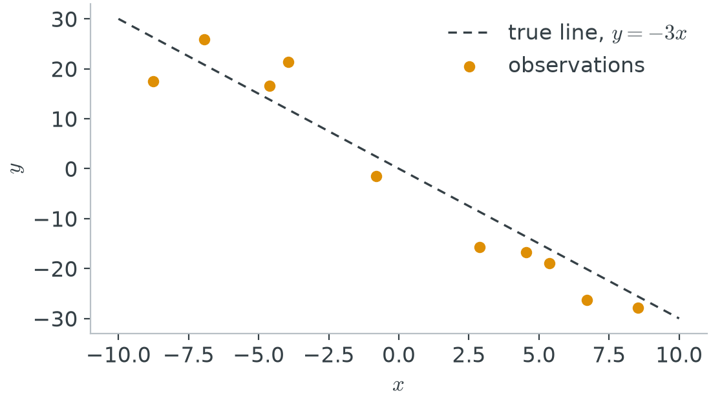]

---

class: middle

.center.width-50[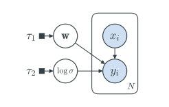]

We model $y$ given $x$ as a line with Gaussian noise, $$p(y \mid x, \mathbf{w}, \log \sigma) = \mathcal{N}(y \mid w\_0 x + w\_1, \sigma^2),$$ where $\mathbf{w} = (w\_0, w\_1)$ holds the slope and the intercept. The priors are $p(\mathbf{w}) = \mathcal{N}(\mathbf{w} \mid \mathbf{0}, \tau\_1^2 \mathbf{I})$ and $p(\log \sigma) = \mathcal{N}(\log \sigma \mid 0, \tau\_2^2)$, with hyperparameters $\tau\_1$ and $\tau\_2$.

---

class: middle

The target distribution is the posterior $p(\mathbf{w}, \log \sigma \mid \mathcal{D})$, which is proportional to the joint density
$$p(\mathbf{w}, \log \sigma \mid \mathcal{D}) \propto \left( \prod\_{i=1}^N p(y\_i \mid x\_i, \mathbf{w}, \log \sigma) \right) p(\mathbf{w}) p(\log \sigma).$$

We can use Metropolis-Hastings to sample from this posterior distribution using the joint density as the unnormalized target density.

---

class: middle

.center.width-70[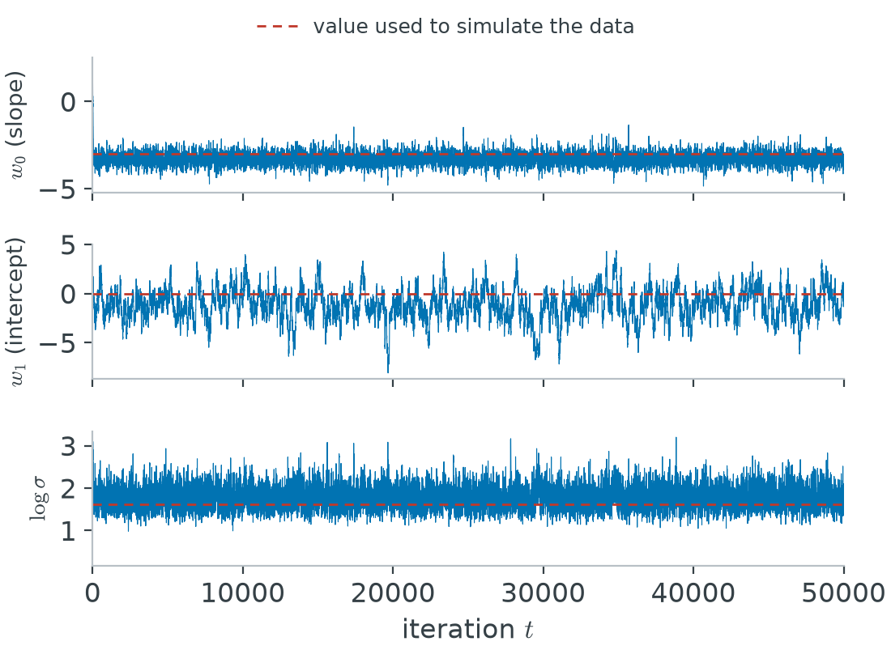]
.center[

Traces of $w\_0$, $w\_1$ and $\log \sigma$ along the Markov chain of Metropolis-Hastings.

]

---

class: middle

.center.width-60[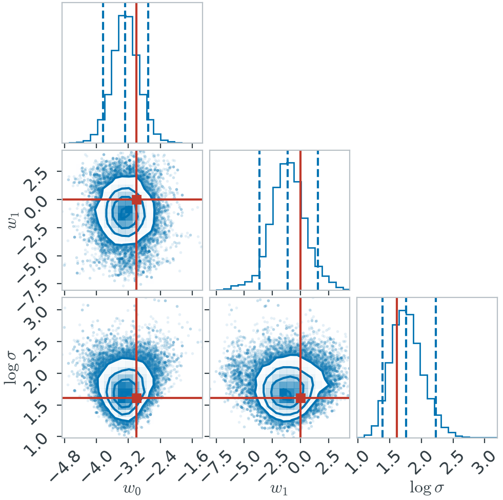]
.center[Posterior samples, after a warm-up of 1000 iterations.]

---

class: middle

.center.width-70[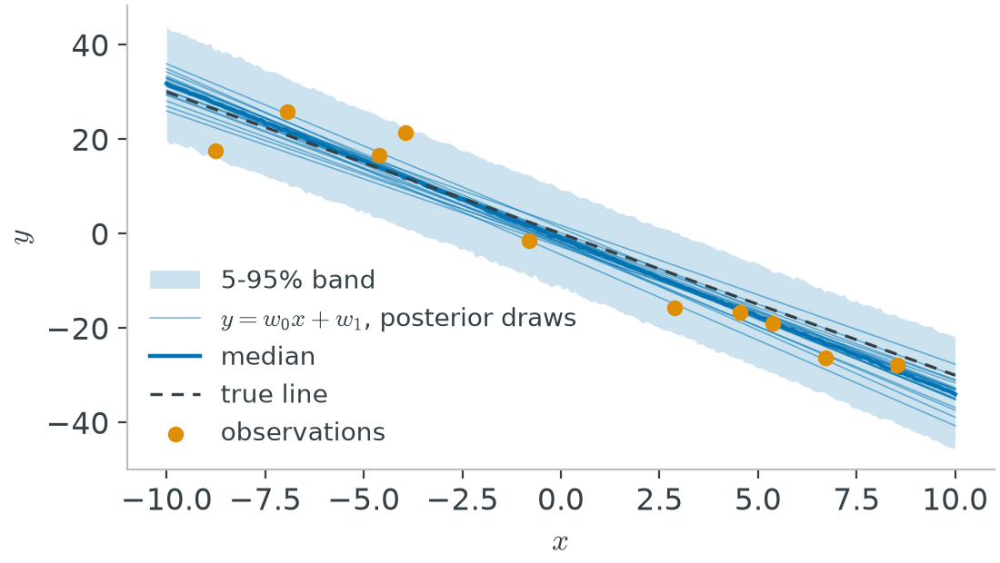]
.center[

Posterior predictive distribution $p(y \mid x, \mathcal{D})$, median and 5-95% band,  with 20 lines $y = w\_0 x + w\_1$ drawn from the posterior.

]

---

class: middle

.center.width-10[]

## Diagnostics for MCMC

The limit theorem guarantees that a chain converges to the target, but not how fast, since $m$ and $\delta$ are unknown. Diagnostics check the chains themselves in terms of .bold[autocorrelation], .bold[mixing] and .bold[convergence].

---

class: middle

.bold[Trace plots] of the Markov chains can reveal mixing, autocorrelation, and convergence issues:

- High autocorrelation is indicated by chains that exhibit strong correlations between successive samples.
- Poor mixing is indicated by chains that explore the state space slowly or get stuck in certain regions.
- When running multiple chains, lack of convergence is indicated by chains that do not overlap or converge to the same distribution.

---

class: middle

.center.width-70[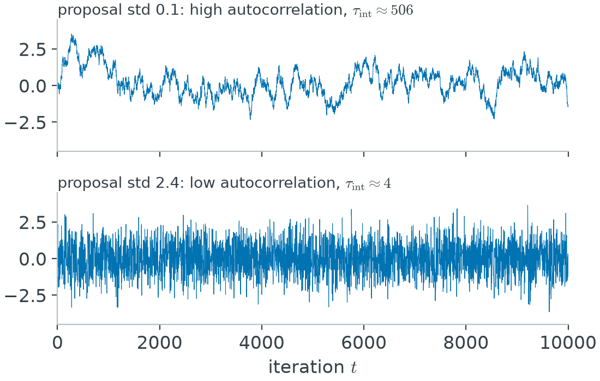]
.center[High vs. low autocorrelation. Highly autocorrelated chains mix poorly.]

---

class: middle

.center.width-70[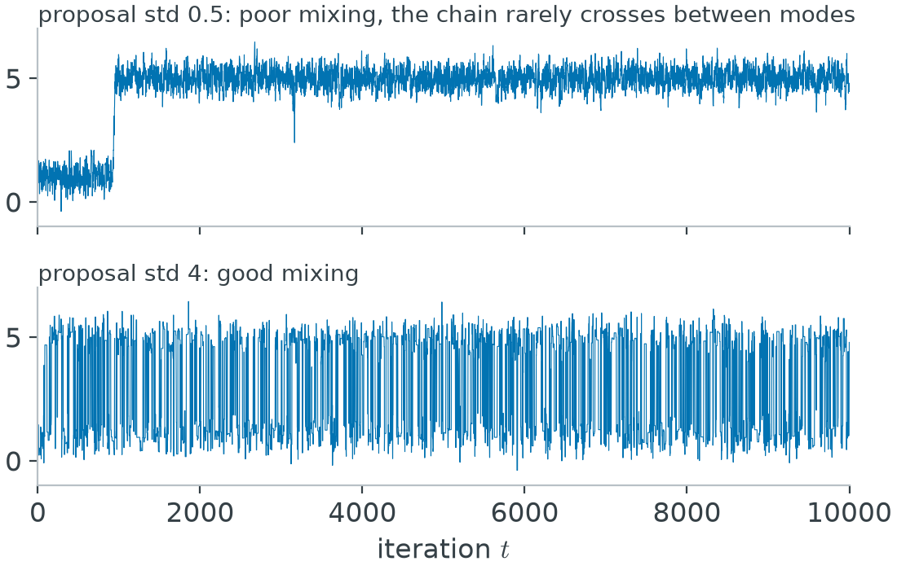]
.center[Poor vs. good mixing for a multimodal target. Poor mixing can be due to small proposal steps or energy barriers between modes.]

---

class: middle

.center.width-70[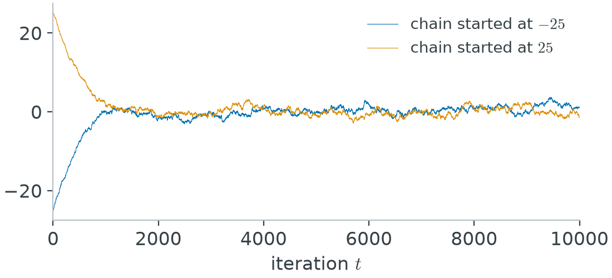]
.center[Two chains run on the same target but initialized differently.   Traces show convergence to the same distribution.]

---

class: middle

## Acceptance rate

The first quantitative diagnostic to monitor is the .bold[acceptance rate], defined as the fraction of proposed samples that are accepted.

- A very low acceptance rate (e.g., < 10%) indicates that the proposal distribution is making too large jumps, leading to many rejections.
- A very high acceptance rate (e.g., > 80%) suggests that the proposal distribution is making too small jumps, resulting in slow exploration of the state space.
- For a Gaussian random-walk proposal, the optimal acceptance rate is about 44% in one dimension and decreases to 23.4% as the dimension grows.

.footnote[Credits: Gelman, Roberts and Gilks, 1996; [Roberts, Gelman and Gilks](https://doi.org/10.1214/aoap/1034625254), 1997.]

---

class: middle

## Effective sample size

By the ergodic theorem, the average of $f(x\_t)$ along the chain converges to $\mathbb{E}\_\pi[f(x)]$. Its precision depends on the autocorrelation at lag $k$,
$$\rho\_k = \frac{\text{Cov}(f(x\_t), f(x\_{t+k}))}{\text{Var}(f(x\_t))}.$$

The integrated autocorrelation time $\tau\_\text{int} = 1 + 2\sum\_{k=1}^{\infty} \rho\_k$ sets the variance of the average of $T$ samples:
$$\text{Var}\left[\frac{1}{T} \sum\_{t=1}^T f(x\_t)\right] \approx \frac{\tau\_\text{int}}{T} \text{Var}(f(x\_t)).$$

The .bold[effective sample size] $\text{ESS} = T / \tau\_\text{int}$ is the number of independent samples whose average has the same variance.

---

class: middle

.center.width-80[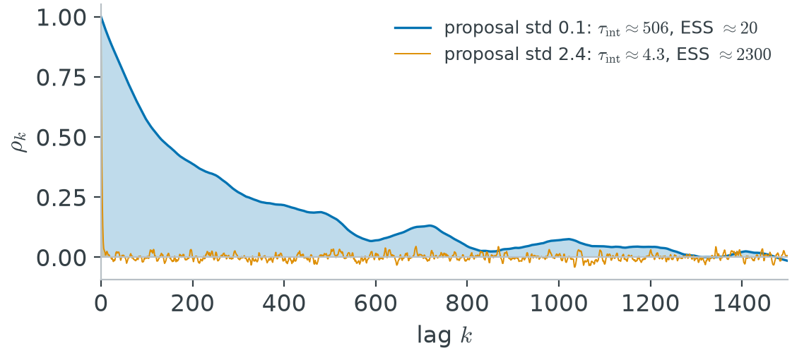]

.center[

Autocorrelation of two random-walk chains of 10000 iterations.  $\tau\_\text{int}$ is one plus twice the shaded area.

]

---

class: middle

## Gelman-Rubin statistic

Run $M$ independent chains of $T$ iterations from dispersed starting points. Once they have all converged to $\pi$, the chains look alike, and the variance within a chain matches the variance of all chains pooled.

The .bold[Gelman-Rubin statistic] compares the two:
$$\hat{R} = \sqrt{\frac{\frac{T-1}{T} W + \frac{1}{T} B}{W}},$$
where $W$ is the average variance within the chains and $B / T$ the variance of the chain means. It approaches 1 as the chains agree.

.footnote[Credits: [Gelman and Rubin](https://doi.org/10.1214/ss/1177011136), 1992.]

---

class: middle

.center.width-80[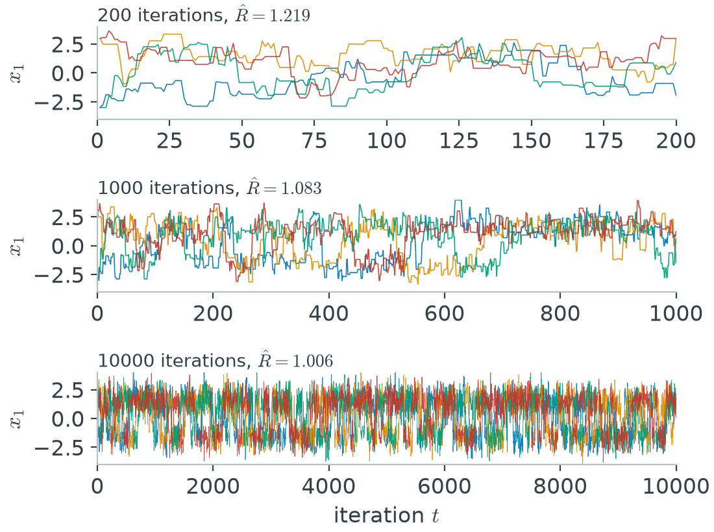]

.center[

Four Metropolis-Hastings chains on the two-mode target, started at its corners.

]

---

class: middle

In practice, $\hat{R}$ is computed on each half of each chain, which catches a chain that drifts, and on the ranks of the draws, which makes it robust to heavy tails.

The chains are run until $\hat{R} < 1.01$ for every quantity of interest.

.footnote[Credits: [Vehtari et al.](https://doi.org/10.1214/20-BA1221), 2021.]

---

class: middle

## Calibration

Diagnostics check that the chains have converged. They do not check that they converged to the right posterior: a bug in the log density goes unnoticed.

Let $\theta$ denote the parameters of a model, $\theta^\* \sim p(\theta)$ and $\mathcal{D} \sim p(\mathcal{D} \mid \theta^\*)$. A credible region $C\_\alpha(\mathcal{D})$ of level $\alpha$ has posterior probability $\alpha$. The exact posterior is .bold[calibrated]: $C\_\alpha(\mathcal{D})$ contains $\theta^\*$ with probability $\alpha$,
$$P(\theta^\* \in C\_\alpha(\mathcal{D})) = \alpha.$$

---

class: middle

## Simulation-based calibration

Simulation-based calibration tests whether a sampler is calibrated. For a scalar parameter $\theta$, repeat for $s = 1, \ldots, S$:
1. Draw $\theta^\*\_s \sim p(\theta)$ and $\mathcal{D}\_s \sim p(\mathcal{D} \mid \theta^\*\_s)$.
2. Draw $L$ samples $\theta\_1, \ldots, \theta\_L$ with the sampler targeting $p(\theta \mid \mathcal{D}\_s)$.
3. Compute the rank $r\_s = \sum\_{l=1}^L \mathbb{1}[\theta\_l < \theta^\*\_s] \in \\{0, \ldots, L\\}$, where $\mathbb{1}[\cdot]$ is 1 if the condition holds and 0 otherwise.

.italic[Proposition.] If the sampler draws independent samples from the exact posterior, the ranks $r\_s$ are uniformly distributed over $\\{0, \ldots, L\\}$.

.italic[Proof.] The pair $(\theta^\*\_s, \mathcal{D}\_s)$ is drawn from the joint $p(\theta, \mathcal{D})$, so given $\mathcal{D}\_s$, $\theta^\*\_s$ is distributed as $p(\theta \mid \mathcal{D}\_s)$. Then $\theta^\*\_s, \theta\_1, \ldots, \theta\_L$ are $L + 1$ independent draws from $p(\theta \mid \mathcal{D}\_s)$. By symmetry, $\theta^\*\_s$ takes any of the $L + 1$ positions in their sorted order with the same probability.

.footnote[Credits: [Talts et al.](https://arxiv.org/abs/1804.06788), 2018.]

---

class: middle

.center.width-80[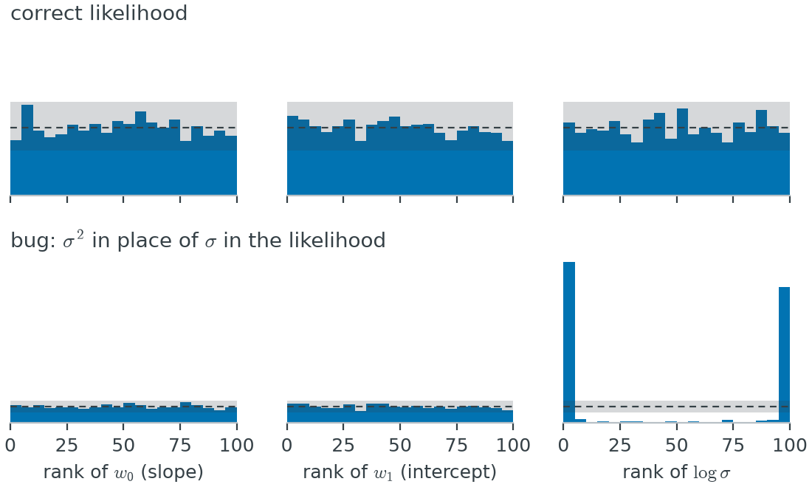]

.center[

Rank histograms of simulation-based calibration for the Bayesian linear regression.  The grey band holds 99% of the counts of uniform ranks.

]

---

class: middle

.center.width-80[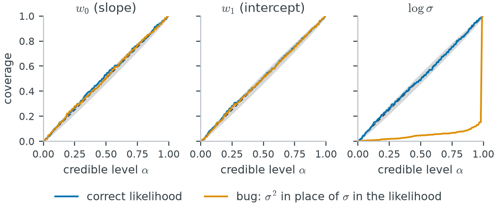]

.center[

Coverage of the central credible intervals of level $\alpha$, read from the same ranks.  A calibrated sampler follows the diagonal, $P(\theta^\* \in C\_\alpha(\mathcal{D})) = \alpha$.

]

---

class: middle, center

.center.width-10[]

Run the end of `nb06b-mcmc.ipynb` to sample the posterior of the wolf's parameters.

---

class: end-slide, center
count: false

The end.
