class: middle, center, title-slide

# Foundations of Data Science

Lecture 7: Model criticism and validation

  
Prof. Gilles Louppe 
[g.louppe@uliege.be](mailto:g.louppe@uliege.be)

---

class: middle, black-slide

.center[
<iframe width="640" height="400" src="https://www.youtube.com/embed/LIxvQMhttq4?cc_load_policy=1&hl=en&version=3" frameborder="0" allowfullscreen></iframe>
]

.quote[If it (a model) disagrees with experiment, it is wrong. In that simple statement is the key to science. .author[Richard Feynman]]

---

class: middle

# Model checking 

---

class: middle

Model checking takes the computation as correct, with samples from the posterior of the model, and asks whether the model explains the data. Only the data can tell: an exact sampler for a wrong model passes every check of the computation.

---

class: middle

## Newcomb's experiment (1882)

Simon Newcomb measured the speed of light with a rotating mirror. He recorded $N = 66$ measurements of the time light takes to travel a known distance.

.center.width-70[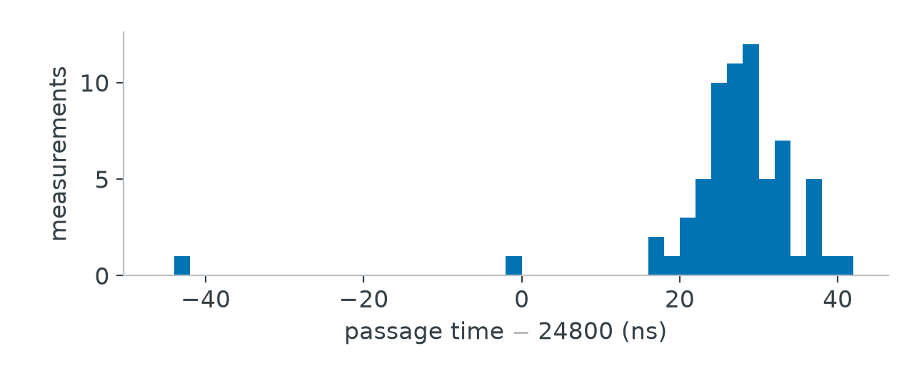]
.center[Newcomb's 66 measurements, in nanoseconds above 24800 ns.]

---

class: middle

.italic[Example.] We model the measurements $\mathbf{x}\_\text{obs} = (x\_1, \ldots, x\_N)$ as independent Gaussian draws,

.center.width-50[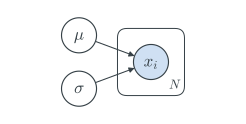]

$$\begin{aligned}
\mu &\sim \mathcal{U}(-1000, 1000) \\\\
\sigma &\sim \mathcal{U}(0.1, 1000) \\\\
x\_i &\sim \mathcal{N}(\mu, \sigma^2) \quad \text{for } i = 1, \ldots, N.
\end{aligned}$$

---

class: middle

.center.width-45[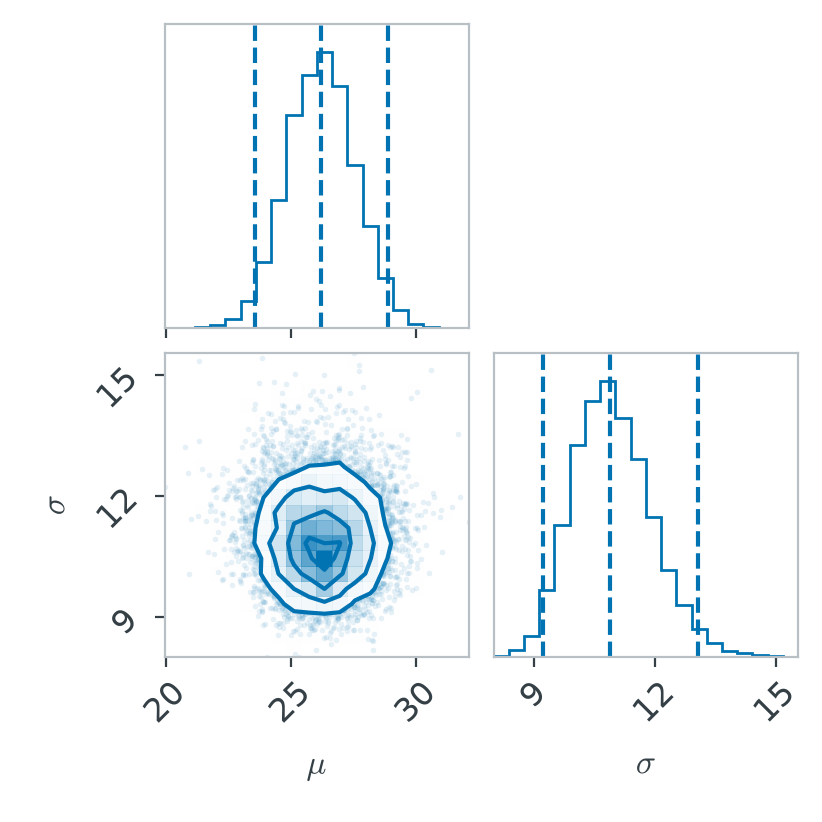]

.center[MCMC samples $(\mu^{(m)}, \sigma^{(m)})$, $m = 1, \ldots, M$, from the posterior $p(\mu, \sigma \mid \mathbf{x}\_\text{obs})$  of the Gaussian model, with the 2.5%, 50% and 97.5% quantiles.]

---

class: middle

The posterior mean of $\mu$ estimates the passage time, in nanoseconds above 24800 ns,
$$\hat{\mu} = \frac{1}{M} \sum\_{m=1}^M \mu^{(m)} = 26.199182694915095.$$

The Monte Carlo standard error of this average, $\text{sd}(\mu^{(m)}) / \sqrt{\text{ESS}}$ with $\text{ESS} \approx 9000$ effective samples, is about 0.01 ns. The posterior standard deviation of $\mu$, the uncertainty about $\mu$ itself, is about 1.4 ns. It decides the digits: report $\mu = 26.2 \pm 1.4$ ns.

---

class: middle

## Credible intervals

A 95% credible interval $[a, b]$ holds 95% of the posterior, $P(a \leq \mu \leq b \mid \mathbf{x}\_\text{obs}) = 0.95$. The .bold[equal-tailed] interval leaves 2.5% on each side; the .bold[highest posterior density] (HPD) interval is the narrowest.

.center.width-70[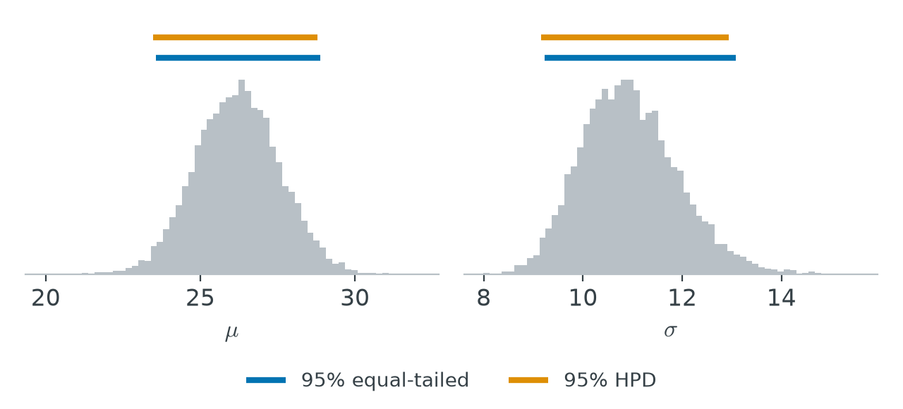]

For $\mu$, the equal-tailed interval is $[23.6, 28.9]$. The probability is over $\mu$, with the data fixed.

---

class: middle

## Posterior predictive checks

A prior predictive check simulates data from $p(\mathbf{x}) = \int p(\mathbf{x} \mid \theta) p(\theta) d\theta$ before any data are seen. A .bold[posterior predictive check] runs the same simulation with the posterior in place of the prior,
$$p(\mathbf{x}^\text{rep} \mid \mathbf{x}\_\text{obs}) = \int p(\mathbf{x}^\text{rep} \mid \theta) p(\theta \mid \mathbf{x}\_\text{obs}) d\theta,$$
and compares the replicated data $\mathbf{x}^\text{rep}$ with the observed data. If the model fits, they look alike.

For Newcomb's data, draw $(\mu^{(m)}, \sigma^{(m)})$ from the posterior, then $N$ measurements $x\_i^{\text{rep}(m)} \sim \mathcal{N}(\mu^{(m)}, (\sigma^{(m)})^2)$.

---

class: middle

.center.width-70[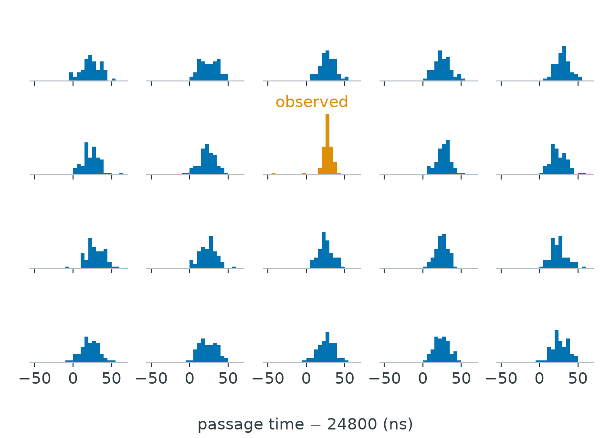]
.center[The observed data among 19 data sets replicated from the posterior predictive.]

---

class: middle

## p-values

A .bold[p-value] fixes the parameters $\theta$, simulates data sets from $p(\mathbf{x} \mid \theta)$, and measures how often a .bold[test statistic] $T$, such as the mean, is at least as large as on the observed data,
$$P(T(\mathbf{x}^\text{rep}) \geq T(\mathbf{x}\_\text{obs}) \mid \theta).$$

.center.width-70[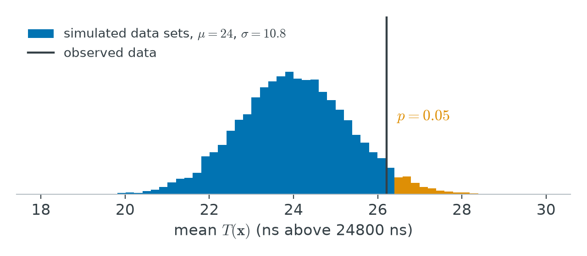]

Near 0 or 1, the model rarely produces data like these. A test at level 5% rejects $\theta$ below 0.05: here, $\mu = 24$ ns is just rejected.

---

class: middle

A frequentist p-value fixes $\theta$ at a hypothesized value $\theta^\*$, or at the estimate $\hat{\theta}$. The .bold[Bayesian p-value] averages over the posterior instead,
$$P(T(\mathbf{x}^\text{rep}) \geq T(\mathbf{x}\_\text{obs}) \mid \mathbf{x}\_\text{obs}) = \int P(T(\mathbf{x}^\text{rep}) \geq T(\mathbf{x}\_\text{obs}) \mid \theta) p(\theta \mid \mathbf{x}\_\text{obs}) d\theta,$$
which is the fraction of replicated data sets whose statistic is at least as large as the observed one.

.center.width-70[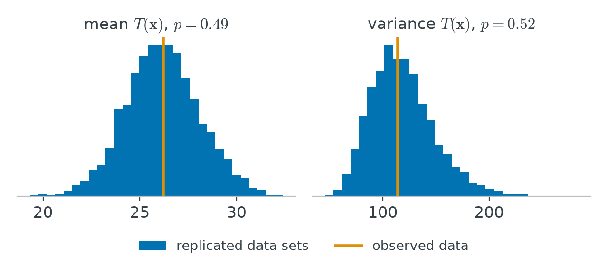]

The mean and the variance of the observed data are typical of the replicated data.

---

class: middle

.center.width-70[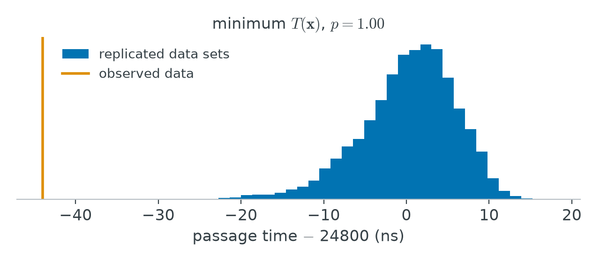]

The observed minimum is lower than the minimum of every replicated data set ($p = 1.00$). The Gaussian model cannot produce the lowest measurements.

---

class: middle

## Residual analysis

When each measurement is a prediction plus noise, $x\_i = f\_i(\theta) + \sigma\epsilon\_i$ with $\epsilon\_i \sim p(\epsilon)$, the standardized .bold[residuals] are
$$r\_i = \frac{x\_i - f\_i(\theta)}{\sigma}, \quad \theta \sim p(\theta \mid \mathbf{x}\_\text{obs}).$$
$f\_i(\theta)$ may depend on an input, as in a regression; in a state-space model, the residuals are the standardized innovations of the Kalman filter.

If the model fits, the residuals of the observed data are distributed as those of replicated data, and close to $p(\epsilon)$ when the posterior is concentrated.

---

class: middle

For the Gaussian model, $r\_i = (x\_i - \mu) / \sigma$. A .bold[quantile-quantile (Q-Q) plot] draws the quantiles of one distribution against those of another: on the diagonal, the two agree.

.center.width-70[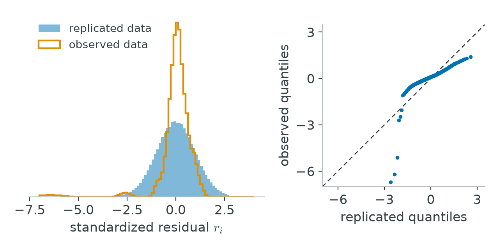]

.center[Residuals of observed and replicated data (left), and their Q-Q plot (right).  The observed residuals have a heavier lower tail and a narrower core.]

---

class: middle

.center.width-10[]

Model checking compares the observed data with data simulated from the fitted model, by plots and by test statistics. It reveals .bold[misspecifications], and points to what the next model must fix.

---

class: middle

# Model comparison

---

class: middle

.italic[Example.] The two lowest measurements could be deleted as outliers, but nothing in the data says they are errors. A heavy-tailed model keeps them: a Student's $t$ gives large deviations a larger probability than a Gaussian.

.center.width-50[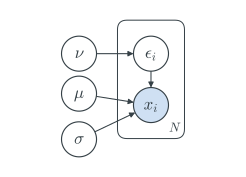]

$$\begin{aligned}
\mu &\sim \mathcal{U}(-1000, 1000) \\\\
\sigma &\sim \mathcal{U}(0.1, 1000) \\\\
\nu &\sim \text{Gamma}(2, 0.1) \\\\
\epsilon\_i &\sim t\_{\nu} \\\\
x\_i &= \mu + \sigma \epsilon\_i \quad \text{for } i = 1, \ldots, N.
\end{aligned}$$

---

class: middle

.center.width-55[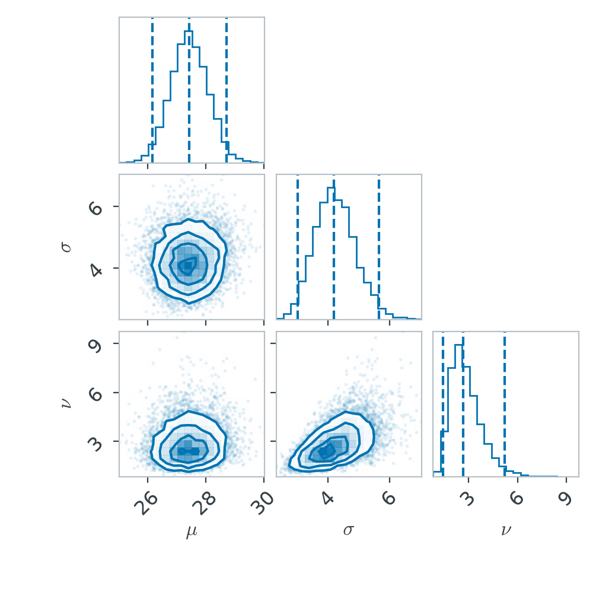]

.center[MCMC samples from the posterior $p(\mu, \sigma, \nu \mid \mathbf{x}\_\text{obs})$ of the $t$ model,  with the 2.5%, 50% and 97.5% quantiles.]

---

class: middle

.center.width-70[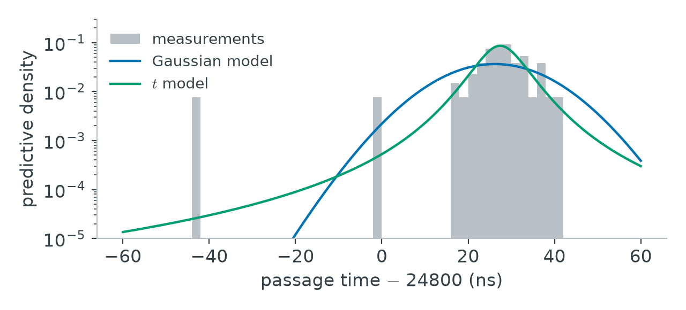]

.center[Posterior predictive densities of the two models, on a log scale.  The Gaussian gives the two lowest measurements almost no probability.]

---

class: middle

## Bayes factors

Consider two models $\mathcal{M}\_1$ and $\mathcal{M}\_2$, with prior probabilities $p(\mathcal{M}\_1)$ and $p(\mathcal{M}\_2)$. Bayes' rule gives the ratio of their posterior probabilities,
$$\frac{p(\mathcal{M}\_1 \mid \mathbf{x}\_\text{obs})}{p(\mathcal{M}\_2 \mid \mathbf{x}\_\text{obs})} = \frac{p(\mathbf{x}\_\text{obs} \mid \mathcal{M}\_1)}{p(\mathbf{x}\_\text{obs} \mid \mathcal{M}\_2)} \frac{p(\mathcal{M}\_1)}{p(\mathcal{M}\_2)}.$$
The first factor on the right is the .bold[Bayes factor] $\text{BF}\_{1,2}$: how much more probable the data are under $\mathcal{M}\_1$ than under $\mathcal{M}\_2$. A common scale reads 1 to 3 as weak evidence for $\mathcal{M}\_1$, 3 to 10 as moderate, above 10 as strong.

For Newcomb's data, $\log \text{BF}\_{t, \text{Gaussian}} \approx 30$. The value depends on the priors: a prior on $\nu$ ten times wider lowers it to about 25, while the priors on $\mu$ and $\sigma$, shared by both models, cancel.

---

class: middle

A Bayes factor is a ratio of .bold[marginal likelihoods],
$$p(\mathbf{x}\_\text{obs} \mid \mathcal{M}) = \int p(\mathbf{x}\_\text{obs} \mid \theta, \mathcal{M}) p(\theta \mid \mathcal{M}) d\theta,$$
the probability of the data averaged over the prior. It is the normalizer of Bayes' rule,
$$p(\theta \mid \mathbf{x}\_\text{obs}, \mathcal{M}) = \frac{p(\mathbf{x}\_\text{obs} \mid \theta, \mathcal{M}) p(\theta \mid \mathcal{M})}{p(\mathbf{x}\_\text{obs} \mid \mathcal{M})}.$$

The integral rarely has a closed form, and MCMC never computes it: it samples the posterior from the unnormalized density alone.

---

class: middle

The .bold[Laplace approximation] replaces the posterior by a Gaussian at its mode $\hat{\theta}$, the maximum a posteriori (MAP) estimate. There the gradient vanishes, and a second-order Taylor expansion of the log posterior is a parabola,
$$\log p(\theta \mid \mathbf{x}\_\text{obs}, \mathcal{M}) \approx \log p(\hat{\theta} \mid \mathbf{x}\_\text{obs}, \mathcal{M}) - \frac{1}{2} (\theta - \hat{\theta})^T \boldsymbol{\Sigma}^{-1} (\theta - \hat{\theta}),$$
with $\boldsymbol{\Sigma}^{-1}$ the Hessian of $-\log p(\theta \mid \mathbf{x}\_\text{obs}, \mathcal{M})$ at $\hat{\theta}$. Hence $p(\theta \mid \mathbf{x}\_\text{obs}, \mathcal{M}) \approx \mathcal{N}(\theta \mid \hat{\theta}, \boldsymbol{\Sigma})$.

.center.width-70[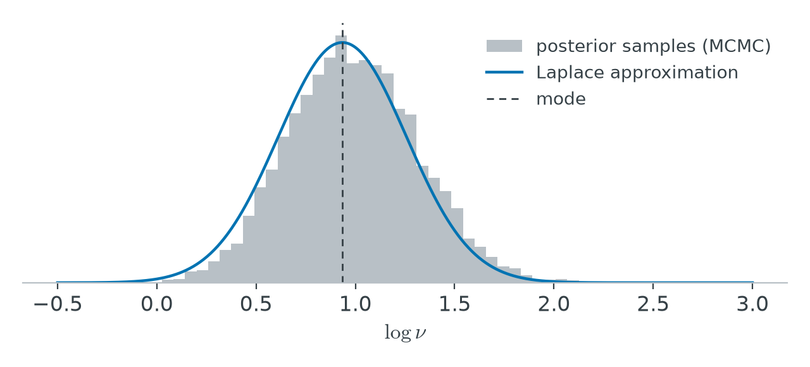]

---

class: middle

Bayes' rule, evaluated at $\hat{\theta}$, and the approximation give
$$\begin{aligned}
p(\mathbf{x}\_\text{obs} \mid \mathcal{M}) &= \frac{p(\mathbf{x}\_\text{obs} \mid \hat{\theta}, \mathcal{M}) p(\hat{\theta} \mid \mathcal{M})}{p(\hat{\theta} \mid \mathbf{x}\_\text{obs}, \mathcal{M})} \\\\
&\approx p(\mathbf{x}\_\text{obs} \mid \hat{\theta}, \mathcal{M}) p(\hat{\theta} \mid \mathcal{M}) (2\pi)^{d/2} |\boldsymbol{\Sigma}|^{1/2},
\end{aligned}$$
where $d$ is the number of parameters and $(2\pi)^{-d/2} |\boldsymbol{\Sigma}|^{-1/2}$ is the density of the Gaussian at its mode.

---

class: middle

## Occam's razor

A model spreads a total probability of one over all possible data sets. A flexible model can produce many of them, so it gives each a small probability. The marginal likelihood therefore prefers the simpler model, unless the data require the flexible one.

.center.width-70[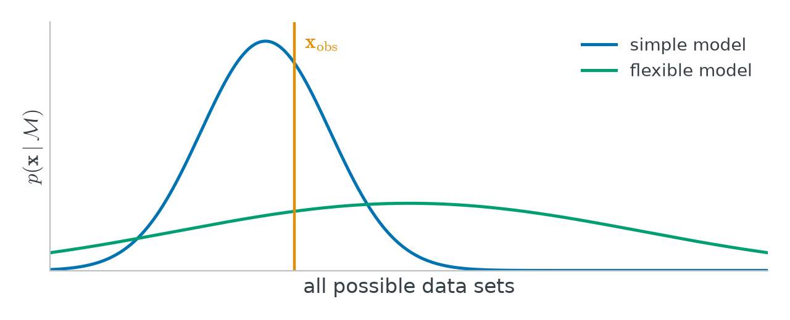]

---

class: middle

.italic[Example.] Polynomial regression of degree 3 and 7, on 20 noisy points.

.center.width-70[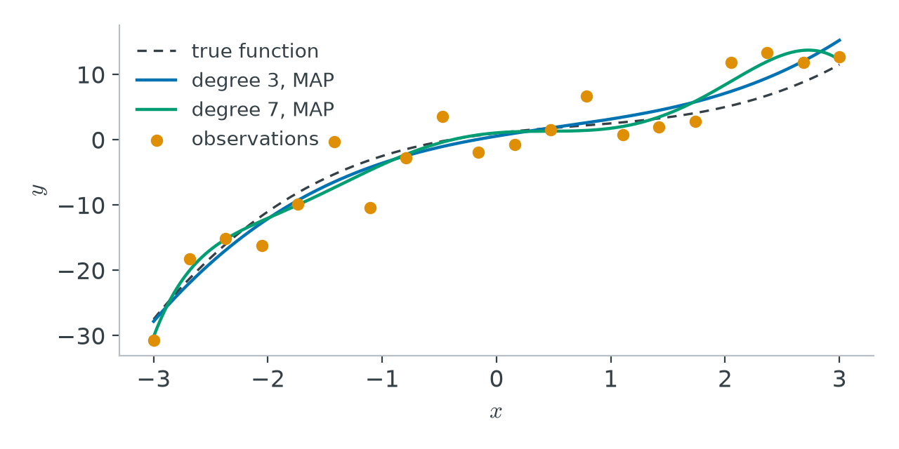]

The marginal likelihood favours degree 3 ($\log p(\mathbf{x}\_\text{obs} \mid \mathcal{M}) \approx -67$) over degree 7 ($\approx -86$), although degree 7 contains degree 3 as a special case.

---

class: middle

## Cross-validation

.bold[Cross-validation] compares models by how well they predict data they were not fitted on.

In .bold[$k$-fold cross-validation], the data are split into $k$ folds of $N / k$ observations. Each fold serves once as the validation set, and the other $k - 1$ folds as the training set. The scores are averaged over the $k$ splits.

.center.width-70[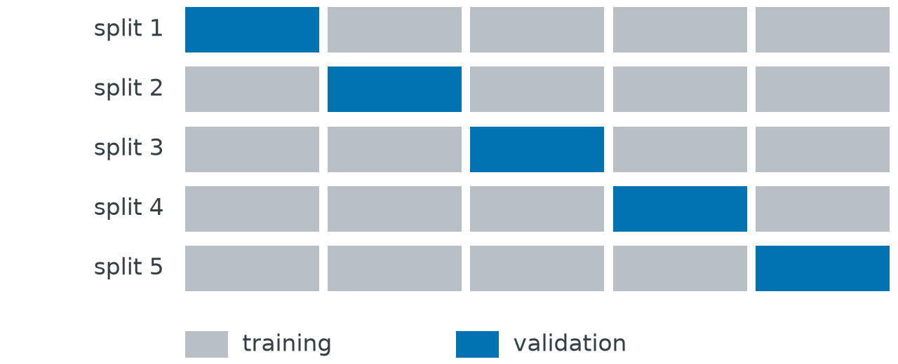]

---

class: middle

The score of a Bayesian model is the .bold[expected log predictive density] (ELPD),
$$\mathbb{E}\_{p\_r(\mathbf{x}')}[\log p(\mathbf{x}' \mid \mathbf{x}\_\text{obs})],$$
where $p\_r$ is the data distribution and $p(\mathbf{x}' \mid \mathbf{x}\_\text{obs})$ is the posterior predictive distribution, fitted on the training set. Cross-validation estimates the expectation with the validation set.

The KL divergence from $p\_r$ to the predictive distribution is $\mathbb{E}\_{p\_r}[\log p\_r(\mathbf{x}')]$ minus the ELPD. The first term does not depend on the model, so a higher ELPD means predictions closer to $p\_r$, with no need for either model to be true.

---

class: middle

For Newcomb's data, 5-fold cross-validation, summed over the 66 held-out measurements, gives an ELPD of $-225$ for the $t$ model and $-287$ for the Gaussian model.

.center.width-70[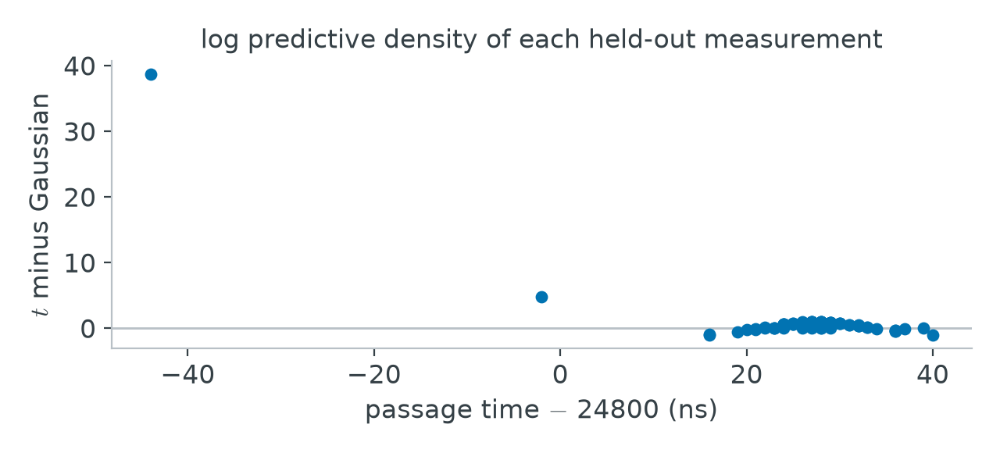]

.center[The two lowest measurements account for about two thirds of the difference.]

With a point estimate $\hat{\theta}$ in place of the posterior, the ELPD reduces to the log-likelihood $\log p(\mathbf{x}' \mid \hat{\theta})$ of the held-out data.

---

class: end-slide, center
count: false

The end.
