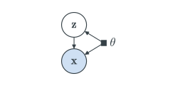
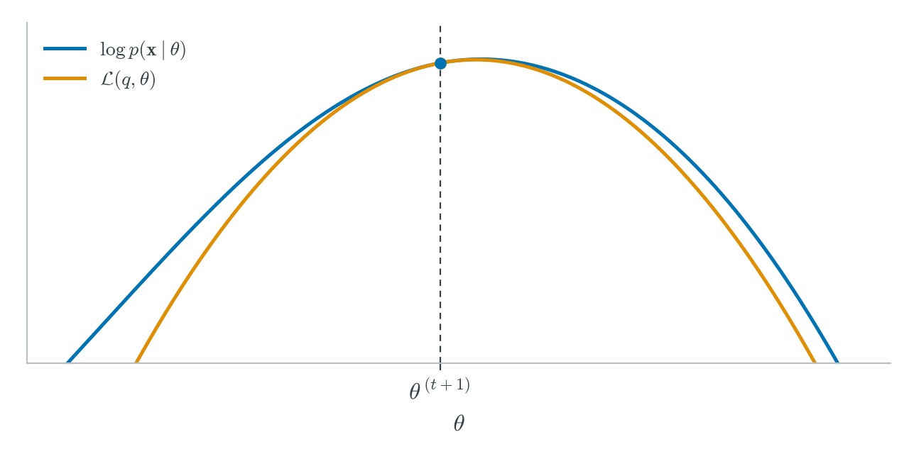
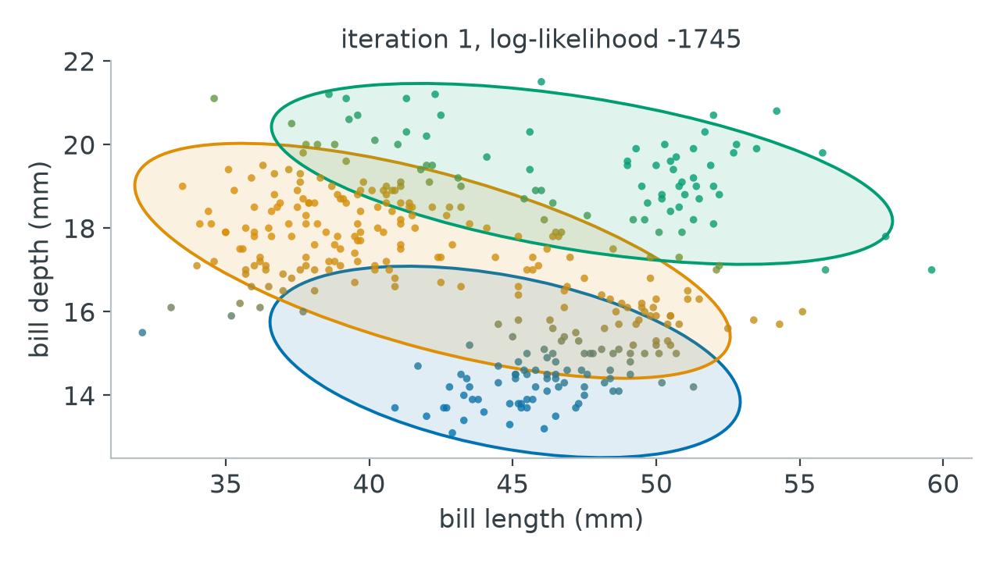
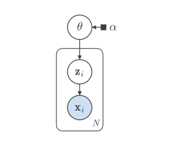

class: middle, center, title-slide

# Foundations of Data Science

Lecture 8: Expectation-maximization

  
Prof. Gilles Louppe 
[g.louppe@uliege.be](mailto:g.louppe@uliege.be)

---

class: middle

.center.width-70[]

.center[Bill length and depth of 342 penguins, with their species left out.]

.question[How many groups are there, and which penguin belongs to which?]

---

class: middle

## Gaussian mixture model

To find groups, we assume that the data come from a few groups, each with its own distribution. Each penguin $i$ belongs to one of $K$ components (here $K = 3$), $z\_i \in \\{1, \ldots, K\\}$, and its bill measurements $\mathbf{x}\_i \in \mathbb{R}^2$ are Gaussian given its component,
$$\begin{aligned}
p(z\_i = k \mid \theta) &= \pi\_k, \\\\
p(\mathbf{x}\_i \mid z\_i = k, \theta) &= \mathcal{N}(\mathbf{x}\_i \mid \boldsymbol{\mu}\_k, \boldsymbol{\Sigma}\_k).
\end{aligned}$$
The parameters $\theta = (\boldsymbol{\pi}, \boldsymbol{\mu}\_{1:K}, \boldsymbol{\Sigma}\_{1:K})$ are the weights, means and covariance matrices of the components. Here they are fixed unknowns, with no prior, to be estimated from the data.

.center.width-50[]

---

class: middle

## Maximum likelihood

The $z\_i$ are not observed. Summing them out gives the likelihood of the data alone,
$$p(\mathbf{x}\_{1:N} \mid \theta) = \prod\_{i=1}^N \sum\_{k=1}^K \pi\_k \mathcal{N}(\mathbf{x}\_i \mid \boldsymbol{\mu}\_k, \boldsymbol{\Sigma}\_k).$$
The latent variables are summed out, and $\theta$ is held fixed. Integrating $\theta$ out too would give $p(\mathbf{x}\_{1:N} \mid \mathcal{M})$, the quantity used to compare models with Bayes factors.

The maximum likelihood estimate maximizes
$$\log p(\mathbf{x}\_{1:N} \mid \theta) = \sum\_{i=1}^N \log \sum\_{k=1}^K \pi\_k \mathcal{N}(\mathbf{x}\_i \mid \boldsymbol{\mu}\_k, \boldsymbol{\Sigma}\_k).$$

---

class: middle

The sum over components sits inside the logarithm. The gradient with respect to $\boldsymbol{\mu}\_k$ is
$$\sum\_{i=1}^N \frac{\pi\_k \mathcal{N}(\mathbf{x}\_i \mid \boldsymbol{\mu}\_k, \boldsymbol{\Sigma}\_k)}{\sum\_{j=1}^K \pi\_j \mathcal{N}(\mathbf{x}\_i \mid \boldsymbol{\mu}\_j, \boldsymbol{\Sigma}\_j)} \boldsymbol{\Sigma}\_k^{-1} (\mathbf{x}\_i - \boldsymbol{\mu}\_k).$$
The weight of each penguin depends on all the parameters, so setting the gradient to zero gives no closed-form solution.

For other latent variable models, the sum becomes an integral over $\mathbf{z}$, which often cannot even be evaluated.

---

class: middle

## If the components were known

With the $z\_i$ observed, the log-likelihood of the complete data splits into one term per component,
$$\log p(\mathbf{x}\_{1:N}, z\_{1:N} \mid \theta) = \sum\_{i=1}^N \log \pi\_{z\_i} + \sum\_{i=1}^N \log \mathcal{N}(\mathbf{x}\_i \mid \boldsymbol{\mu}\_{z\_i}, \boldsymbol{\Sigma}\_{z\_i}).$$

The mean $\boldsymbol{\mu}\_k$ appears only in the terms of the $N\_k$ penguins with $z\_i = k$,
$$-\frac{1}{2} \sum\_{i : z\_i = k} (\mathbf{x}\_i - \boldsymbol{\mu}\_k)^T \boldsymbol{\Sigma}\_k^{-1} (\mathbf{x}\_i - \boldsymbol{\mu}\_k) + \text{const}.$$
Its gradient with respect to $\boldsymbol{\mu}\_k$ is $\sum\_{i : z\_i = k} \boldsymbol{\Sigma}\_k^{-1} (\mathbf{x}\_i - \boldsymbol{\mu}\_k)$. Setting it to zero gives
$$\boldsymbol{\mu}\_k = \frac{1}{N\_k} \sum\_{i : z\_i = k} \mathbf{x}\_i.$$

---

class: middle

In the same way, each parameter is the maximum likelihood estimate of its own component,
$$\begin{aligned}
\boldsymbol{\mu}\_k &= \frac{1}{N\_k} \sum\_{i : z\_i = k} \mathbf{x}\_i, \\\\
\boldsymbol{\Sigma}\_k &= \frac{1}{N\_k} \sum\_{i : z\_i = k} (\mathbf{x}\_i - \boldsymbol{\mu}\_k)(\mathbf{x}\_i - \boldsymbol{\mu}\_k)^T, \\\\
\pi\_k &= \frac{N\_k}{N},
\end{aligned}$$
the mean, the covariance and the fraction of the penguins in component $k$.

---

class: middle

.center.width-10[]

The $z\_i$ are unknown, but given $\theta$ their posterior is easy to compute. This suggests an iteration.
1. Compute the posterior of each $z\_i$ under the current $\theta$.
2. Refit $\theta$ as if the components were known, with each penguin counted in each component with its posterior probability.
3. Repeat.

---

class: middle

# Expectation-maximization

---

class: middle

.center.width-50[]

The iteration above is an instance of a general algorithm. Consider a model $p(\mathbf{x}, \mathbf{z} \mid \theta)$ with latent variables $\mathbf{z}$ and parameters $\theta$. Expectation-maximization (EM) looks for the maximum likelihood estimate
$$\hat{\theta} = \arg\max\_\theta \log p(\mathbf{x} \mid \theta), \quad \text{with } p(\mathbf{x} \mid \theta) = \int p(\mathbf{x}, \mathbf{z} \mid \theta) d\mathbf{z}.$$

EM returns one value $\hat{\theta}$, with no uncertainty on $\theta$. Sampling the posterior of $\theta$ with MCMC keeps that uncertainty, at a higher cost.

---

class: middle

## Two tools

The log-likelihood $\log p(\mathbf{x} \mid \theta)$ is hard to maximize. EM maximizes instead a lower bound on it, built with two tools.

The logarithm is concave. For any positive random variable $Y$, this gives .bold[Jensen's inequality],
$$\log \mathbb{E}[Y] \geq \mathbb{E}[\log Y],$$
with equality when $Y$ is constant.

The .bold[Kullback-Leibler divergence] between two distributions $q$ and $p$ is
$$\text{KL}(q \\| p) = \mathbb{E}\_{q(\mathbf{z})}\left[\log \frac{q(\mathbf{z})}{p(\mathbf{z})}\right].$$
By Jensen's inequality,
$$-\text{KL}(q \\| p) = \mathbb{E}\_{q}\left[\log \frac{p(\mathbf{z})}{q(\mathbf{z})}\right] \leq \log \mathbb{E}\_{q}\left[\frac{p(\mathbf{z})}{q(\mathbf{z})}\right] = \log 1 = 0.$$
The divergence is nonnegative, and zero only when $q = p$.

---

class: middle

## Evidence lower bound

Let $q(\mathbf{z})$ be any distribution over the latent variables. Then
$$\begin{aligned}
\log p(\mathbf{x} \mid \theta) &= \log \int q(\mathbf{z}) \frac{p(\mathbf{x}, \mathbf{z} \mid \theta)}{q(\mathbf{z})} d\mathbf{z} = \log \mathbb{E}\_{q(\mathbf{z})}\left[\frac{p(\mathbf{x}, \mathbf{z} \mid \theta)}{q(\mathbf{z})}\right] \\\\
&\geq \mathbb{E}\_{q(\mathbf{z})}\left[\log \frac{p(\mathbf{x}, \mathbf{z} \mid \theta)}{q(\mathbf{z})}\right] = \mathcal{L}(q, \theta)
\end{aligned}$$
by Jensen's inequality. $\mathcal{L}(q, \theta)$ is the .bold[evidence lower bound] (ELBO).

---

class: middle

Writing $p(\mathbf{x}, \mathbf{z} \mid \theta) = p(\mathbf{z} \mid \mathbf{x}, \theta) p(\mathbf{x} \mid \theta)$ gives the size of the gap,
$$\begin{aligned}
\mathcal{L}(q, \theta) &= \mathbb{E}\_{q(\mathbf{z})}\left[\log \frac{p(\mathbf{z} \mid \mathbf{x}, \theta)}{q(\mathbf{z})}\right] + \log p(\mathbf{x} \mid \theta) \\\\
&= \log p(\mathbf{x} \mid \theta) - \text{KL}(q(\mathbf{z}) \\| p(\mathbf{z} \mid \mathbf{x}, \theta)).
\end{aligned}$$

The ELBO lies below the log-likelihood by the KL divergence between $q$ and the posterior of the latent variables. It touches the log-likelihood when $q$ is that posterior.

---

class: middle

.center.width-70[]

.center[For a distribution $q$ other than the posterior at $\theta^{(t)}$,  the ELBO lies below the log-likelihood at $\theta^{(t)}$.]

---

class: middle

.center.width-70[]

.center[With $q$ set to the posterior at $\theta^{(t)}$, the gap at $\theta^{(t)}$ vanishes.]

---

class: middle

## The algorithm

The bound is tight when $q$ is the posterior, and it can be raised by moving $\theta$. EM alternates between the two. Start from initial parameters $\theta^{(0)}$, then repeat for $t = 0, 1, 2, \ldots$
- .bold[E-step]: $q^{(t+1)} = \arg\max\_q \mathcal{L}(q, \theta^{(t)})$,
- .bold[M-step]: $\theta^{(t+1)} = \arg\max\_\theta \mathcal{L}(q^{(t+1)}, \theta)$.

EM maximizes the ELBO over $q$ and $\theta$ in turn.

---

class: middle

The E-step sets $q$ to the posterior,
$$q^{(t+1)}(\mathbf{z}) = p(\mathbf{z} \mid \mathbf{x}, \theta^{(t)}).$$
.italic[Proof.] $\mathcal{L}(q, \theta^{(t)}) = \log p(\mathbf{x} \mid \theta^{(t)}) - \text{KL}(q(\mathbf{z}) \\| p(\mathbf{z} \mid \mathbf{x}, \theta^{(t)}))$. The first term does not depend on $q$, and the KL divergence is smallest, zero, when $q$ is the posterior. □

The M-step maximizes the expected complete-data log-likelihood,
$$\theta^{(t+1)} = \arg\max\_\theta \mathbb{E}\_{q^{(t+1)}(\mathbf{z})}\left[\log p(\mathbf{x}, \mathbf{z} \mid \theta)\right].$$
.italic[Proof.] $\mathcal{L}(q^{(t+1)}, \theta) = \mathbb{E}\_{q^{(t+1)}}\left[\log p(\mathbf{x}, \mathbf{z} \mid \theta)\right] - \mathbb{E}\_{q^{(t+1)}}\left[\log q^{(t+1)}(\mathbf{z})\right]$, and the second term does not depend on $\theta$. □

---

class: middle

.center.width-70[]

.center[The M-step moves $\theta^{(t)}$ to the maximum of the ELBO, $\theta^{(t+1)}$.]

---

class: middle

.center.width-70[]

.center[The next E-step closes the gap at $\theta^{(t+1)}$, where the log-likelihood is higher.]

---

class: middle

.italic[Proposition.] EM never decreases the log-likelihood,
$$\log p(\mathbf{x} \mid \theta^{(t)}) \leq \log p(\mathbf{x} \mid \theta^{(t+1)}) \quad \text{for all } t \geq 0.$$

.italic[Proof.]
$$\begin{aligned}
\log p(\mathbf{x} \mid \theta^{(t)}) &= \mathcal{L}(q^{(t+1)}, \theta^{(t)}) && \text{(the E-step closes the gap)} \\\\
&\leq \mathcal{L}(q^{(t+1)}, \theta^{(t+1)}) && \text{(the M-step maximizes over } \theta\text{)} \\\\
&\leq \log p(\mathbf{x} \mid \theta^{(t+1)}) && \text{(the ELBO is a lower bound)}. \quad □
\end{aligned}$$

---

class: middle

## EM for the Gaussian mixture

For the mixture, the two steps give back the iteration of the opening slides. With the current parameters $\theta^{(t)}$, the E-step computes for each penguin $i$ and component $k$ the .bold[responsibility]
$$r\_{ik} = q^{(t+1)}(z\_i = k) = \frac{\pi\_k \mathcal{N}(\mathbf{x}\_i \mid \boldsymbol{\mu}\_k, \boldsymbol{\Sigma}\_k)}{\sum\_{j=1}^K \pi\_j \mathcal{N}(\mathbf{x}\_i \mid \boldsymbol{\mu}\_j, \boldsymbol{\Sigma}\_j)}.$$
It is the weight that appeared in the gradient of the log-likelihood.

The M-step maximizes
$$\mathbb{E}\_{q^{(t+1)}}\left[\log p(\mathbf{x}\_{1:N}, z\_{1:N} \mid \theta)\right] = \sum\_{i=1}^N \sum\_{k=1}^K r\_{ik} \left[\log \pi\_k + \log \mathcal{N}(\mathbf{x}\_i \mid \boldsymbol{\mu}\_k, \boldsymbol{\Sigma}\_k)\right],$$
the complete-data log-likelihood with each indicator of $z\_i = k$ replaced by $r\_{ik}$.

---

class: middle

The derivation for known components carries over with weights. The gradient with respect to $\boldsymbol{\mu}\_k$ is $\sum\_{i} r\_{ik} \boldsymbol{\Sigma}\_k^{-1} (\mathbf{x}\_i - \boldsymbol{\mu}\_k)$, and setting it to zero gives the first update below. With $N\_k = \sum\_{i} r\_{ik}$,
$$\begin{aligned}
\boldsymbol{\mu}\_k^{(t+1)} &= \frac{1}{N\_k} \sum\_{i=1}^N r\_{ik} \mathbf{x}\_i, \\\\
\boldsymbol{\Sigma}\_k^{(t+1)} &= \frac{1}{N\_k} \sum\_{i=1}^N r\_{ik} (\mathbf{x}\_i - \boldsymbol{\mu}\_k^{(t+1)})(\mathbf{x}\_i - \boldsymbol{\mu}\_k^{(t+1)})^T, \\\\
\pi\_k^{(t+1)} &= \frac{N\_k}{N}.
\end{aligned}$$

---

class: middle

.center.width-70[]

.center[Each penguin is coloured by its responsibilities,  each component drawn at two standard deviations.]

---

class: middle
count: false

.center.width-70[]

---

class: middle
count: false

.center.width-70[]

---

class: middle
count: false

.center.width-70[]

---

class: middle
count: false

.center.width-70[]

---

class: middle
count: false

.center.width-70[]

.center[The three components match the species of 96% of the penguins.]

---

class: middle

Since the log-likelihood only increases, EM climbs to a maximum, which depends on $\theta^{(0)}$ and may be local. In practice, it is run from several initial values, and the run with the highest log-likelihood is kept.

.center.width-70[]

.center[Two runs of EM on the penguin bills, from different initial values.  The second stops at a local maximum.]

Relabelling the components gives the same likelihood, so each maximum comes in $K!$ equivalent copies.

---

class: middle

## Empirical Bayes

EM estimates parameters by maximizing a marginal likelihood. The same idea applies one level up. In a Bayesian model, the prior $p(\theta \mid \alpha)$ has hyperparameters $\alpha$, so far fixed. .bold[Empirical Bayes] estimates them from the data, by maximizing
$$p(\mathbf{x} \mid \alpha) = \iint p(\mathbf{x}, \mathbf{z} \mid \theta) p(\theta \mid \alpha) d\mathbf{z} d\theta,$$
and uses the prior $p(\theta \mid \hat{\alpha})$.

For example, the distances of $N$ stars can share a prior whose length scale is estimated from all the stars together.

The data are used twice, to set the prior and to update it. Empirical Bayes often works well in practice nonetheless.

---

class: middle

.center.width-50[]

EM applies with both $\mathbf{z}$ and $\theta$ as latent variables.
- E-step: compute the posterior $q^{(t+1)}(\mathbf{z}, \theta) = p(\mathbf{z}, \theta \mid \mathbf{x}, \alpha^{(t)})$.
- M-step: maximize $\mathbb{E}\_{q^{(t+1)}}\left[\log p(\mathbf{x}, \mathbf{z} \mid \theta) + \log p(\theta \mid \alpha)\right]$ over $\alpha$. Only the second term depends on $\alpha$, so
$$\alpha^{(t+1)} = \arg\max\_\alpha \mathbb{E}\_{q^{(t+1)}(\theta)}\left[\log p(\theta \mid \alpha)\right].$$

---

class: middle

## Learning diffusion priors by EM

The prior can itself be a deep generative model, such as a diffusion model. EM then learns it from noisy and incomplete observations only.

.center.width-90[]

.footnote[Credits: [Rozet et al](https://arxiv.org/abs/2405.13712), 2024.]

---

class: middle

.center.width-90[]

.footnote[Credits: [Rozet et al](https://arxiv.org/abs/2405.13712), 2024.]

---

class: middle

## Beyond EM

EM needs the exact posterior $p(\mathbf{z} \mid \mathbf{x}, \theta)$ in its E-step. It is available for a mixture, a sum over $K$ components, and for a linear Gaussian state-space model, where the E-step is the Kalman smoother.

When the posterior is intractable, the ELBO can still be maximized over a family of simpler distributions $q$. This is .bold[variational inference].

---

class: end-slide, center
count: false

The end.
