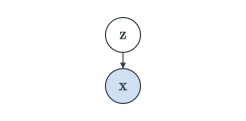
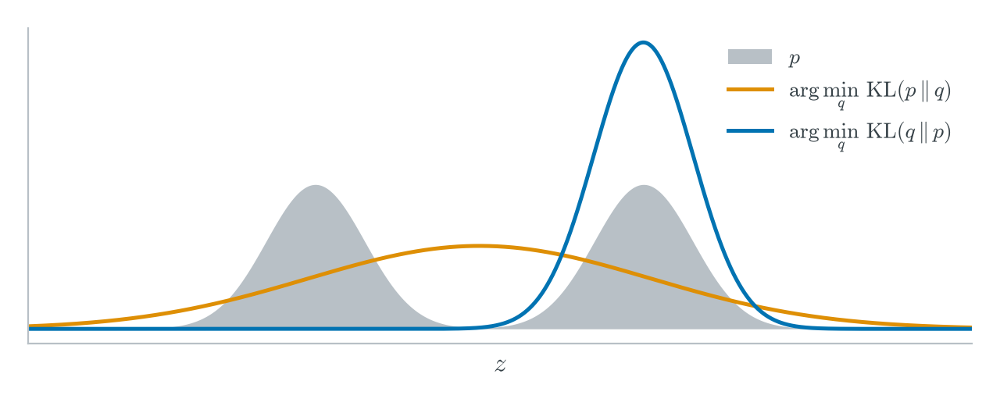
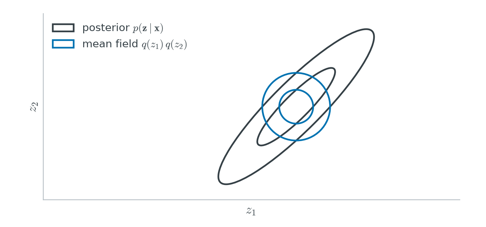
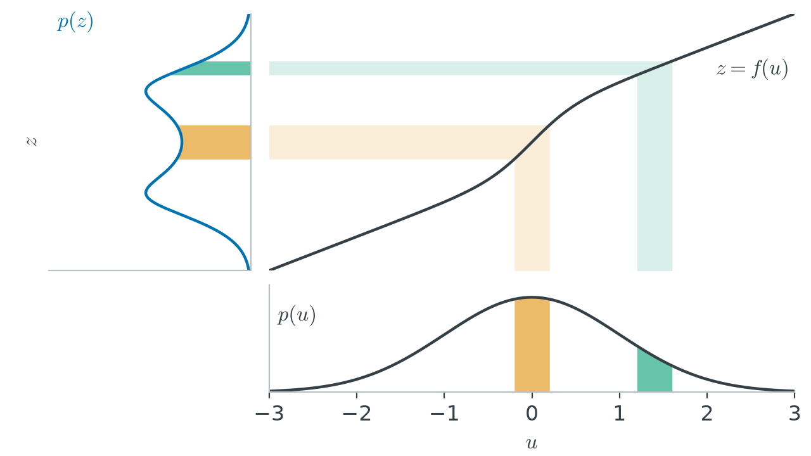
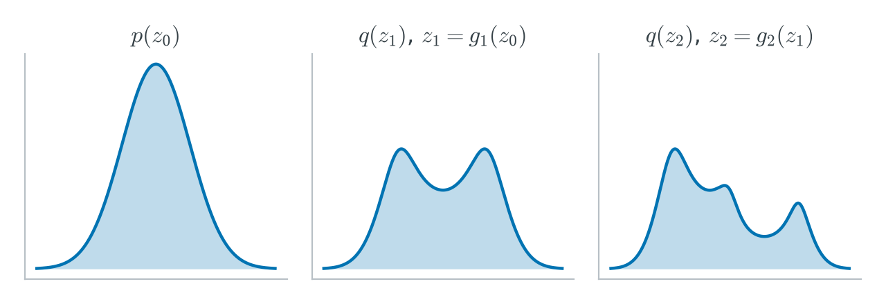
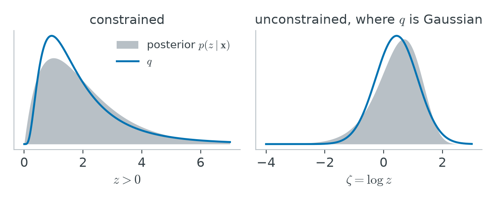
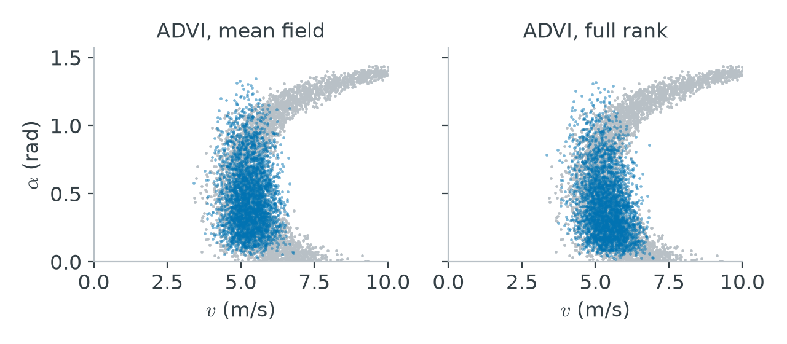

class: middle, center, title-slide

# Foundations of Data Science

Lecture 9: Variational inference

  
Prof. Gilles Louppe 
[g.louppe@uliege.be](mailto:g.louppe@uliege.be)

---

class: middle

.center.width-50[]

The E-step of EM sets $q$ to the posterior of the latent variables. When the posterior is intractable, the ELBO can still be maximized over a family $\mathcal{Q}$ of simpler distributions. This is .bold[variational inference] (VI).

In this lecture, $\mathbf{z}$ gathers all the unknowns, parameters included. EM estimated the parameters by a point. VI approximates the posterior of all the unknowns, as MCMC does, but by optimization instead of sampling.

---

class: middle

# Variational inference

---

class: middle

## Evidence lower bound

For any distribution $q(\mathbf{z})$, we showed that
$$\log p(\mathbf{x}) = \mathcal{L}(q) + \text{KL}(q(\mathbf{z}) \\| p(\mathbf{z} \mid \mathbf{x})), \qquad \mathcal{L}(q) = \mathbb{E}\_{q(\mathbf{z})}\left[\log \frac{p(\mathbf{x}, \mathbf{z})}{q(\mathbf{z})}\right].$$
The left side does not depend on $q$. Variational inference solves
$$q^\* = \arg\max\_{q \in \mathcal{Q}} \mathcal{L}(q) = \arg\min\_{q \in \mathcal{Q}} \text{KL}(q(\mathbf{z}) \\| p(\mathbf{z} \mid \mathbf{x})).$$

The ELBO needs only the joint density $p(\mathbf{x}, \mathbf{z})$, never the posterior. If $\mathcal{Q}$ holds every distribution, $q^\*$ is the posterior, as in the E-step.

---

class: middle

The KL divergence is not symmetric. The .bold[forward] divergence $\text{KL}(p(\mathbf{z} \mid \mathbf{x}) \\| q(\mathbf{z}))$ is an expectation over the posterior, so it would need samples of the posterior. VI minimizes the .bold[reverse] divergence $\text{KL}(q(\mathbf{z}) \\| p(\mathbf{z} \mid \mathbf{x}))$, an expectation over $q$.

.center.width-70[]

.center[The Gaussian closest to a two-mode $p$ in each direction.  The forward divergence covers both modes; the reverse one settles on one.]

---

class: middle

## Mean-field variational inference

The simplest family assumes the latent variables independent under $q$,
$$q(\mathbf{z}) = \prod\_{j=1}^m q\_j(z\_j).$$
This is the .bold[mean-field] family.

.center.width-70[]

.center[The mean-field Gaussian that maximizes the ELBO for a correlated posterior.  It misses the correlation, and it is too narrow in every direction.]

---

class: middle

## Change of variables

A richer family transforms a simple distribution. Let $\mathbf{u} \sim p(\mathbf{u})$ and $\mathbf{z} = f(\mathbf{u})$, with $f$ invertible and differentiable. Probability mass is conserved in every small region, so
$$p(\mathbf{z}) = p(\mathbf{u}) \left| \det J\_f(\mathbf{u}) \right|^{-1}, \qquad \mathbf{u} = f^{-1}(\mathbf{z}),$$
where $J\_f$ is the Jacobian of $f$, and $\left| \det J\_f(\mathbf{u}) \right|$ the factor by which $f$ scales volumes around $\mathbf{u}$.

.center.width-70[]

.center[A Gaussian through an invertible $f$. Each shaded interval keeps its mass,  so where $f$ stretches, around 0, the density drops.]

???

For a linear map $f(\mathbf{u}) = 2\mathbf{u}$ in three dimensions, a unit cube becomes a cube of volume 8, and the density is divided by $8 = |\det(2 I)|$.

The sign of the determinant gives the orientation; its absolute value gives the scaling of volumes, an expansion when it is larger than 1.

---

class: middle

## Normalizing flows

A .bold[normalizing flow] composes $K$ invertible functions, $\mathbf{z}\_K = f\_K \circ \cdots \circ f\_1(\mathbf{z}\_0)$ with $\mathbf{z}\_0 \sim p(\mathbf{z}\_0)$, each a neural network built to be invertible with a cheap Jacobian determinant. Applying the change of variables once per function,
$$\log q(\mathbf{z}\_K) = \log p(\mathbf{z}\_0) - \sum\_{k=1}^K \log \left| \det J\_{f\_k}(\mathbf{z}\_{k-1}) \right|.$$

.center.width-70[]

.center[A Gaussian through two invertible functions.  Each one reshapes the density, which stays exact.]

---

class: middle

## Automatic differentiation variational inference

ADVI maximizes the ELBO by stochastic gradient ascent. It needs only $\log p(\mathbf{x}, \mathbf{z})$ and its gradient, the same ingredients as HMC, so it applies to any model whose log density is written as a program. It proceeds in three steps.
1. Map the latent variables to $\mathbb{R}^m$.
2. Choose a Gaussian family in $\mathbb{R}^m$.
3. Follow stochastic gradients of the ELBO.

.footnote[Credits: [Kucukelbir et al](https://arxiv.org/abs/1603.00788), 2016.]

---

class: middle

Latent variables may be constrained, such as a positive scale. ADVI maps them to $\mathbb{R}^m$ with an invertible $T$, for instance $\zeta = \log z$ for $z > 0$. With $\boldsymbol{\zeta} = T(\mathbf{z})$, the change of variables gives
$$p(\mathbf{x}, \boldsymbol{\zeta}) = p(\mathbf{x}, T^{-1}(\boldsymbol{\zeta})) \left| \det J\_{T^{-1}}(\boldsymbol{\zeta}) \right|.$$

.center.width-70[]

.center[A posterior on $z > 0$, and the Gaussian $q$ fitted to it in $\zeta = \log z$.  Mapped back, $q$ stays positive and skewed.]

---

class: middle

In $\mathbb{R}^m$, the variational family is Gaussian, with variational parameters $\phi$.
- Mean field, $q(\boldsymbol{\zeta}; \phi) = \mathcal{N}(\boldsymbol{\zeta} \mid \boldsymbol{\mu}, \text{diag}(\boldsymbol{\sigma}^2))$, with $\phi = (\boldsymbol{\mu}, \boldsymbol{\sigma})$.
- Full rank, $q(\boldsymbol{\zeta}; \phi) = \mathcal{N}(\boldsymbol{\zeta} \mid \boldsymbol{\mu}, \mathbf{L} \mathbf{L}^T)$, with $\phi = (\boldsymbol{\mu}, \mathbf{L})$ and $\mathbf{L}$ lower triangular.

In both, $\boldsymbol{\zeta} = \boldsymbol{\mu} + \mathbf{L} \boldsymbol{\epsilon}$ with $\boldsymbol{\epsilon} \sim \mathcal{N}(\mathbf{0}, \mathbf{I})$, and $\mathbf{L} = \text{diag}(\boldsymbol{\sigma})$ for the mean field.

The ELBO becomes $\mathcal{L}(\phi) = \mathbb{E}\_{q(\boldsymbol{\zeta}; \phi)}\left[g\_\phi(\boldsymbol{\zeta})\right]$, with
$$g\_\phi(\boldsymbol{\zeta}) = \log p(\mathbf{x}, T^{-1}(\boldsymbol{\zeta})) + \log \left| \det J\_{T^{-1}}(\boldsymbol{\zeta}) \right| - \log q(\boldsymbol{\zeta}; \phi).$$

---

class: middle

The expectation is over $q$, which depends on $\phi$. Writing $\boldsymbol{\zeta} = \boldsymbol{\mu} + \mathbf{L} \boldsymbol{\epsilon}$ moves $\phi$ inside the expectation. This is the .bold[reparameterization],
$$\begin{aligned}
\mathcal{L}(\phi) &= \mathbb{E}\_{\mathcal{N}(\boldsymbol{\epsilon} \mid \mathbf{0}, \mathbf{I})}\left[g\_\phi(\boldsymbol{\mu} + \mathbf{L} \boldsymbol{\epsilon})\right], \\\\
\nabla\_\phi \mathcal{L}(\phi) &= \mathbb{E}\_{\mathcal{N}(\boldsymbol{\epsilon} \mid \mathbf{0}, \mathbf{I})}\left[\nabla\_\phi \, g\_\phi(\boldsymbol{\mu} + \mathbf{L} \boldsymbol{\epsilon})\right] \\\\
&\approx \frac{1}{B} \sum\_{b=1}^B \nabla\_\phi \, g\_\phi(\boldsymbol{\mu} + \mathbf{L} \boldsymbol{\epsilon}\_b), \qquad \boldsymbol{\epsilon}\_b \sim \mathcal{N}(\mathbf{0}, \mathbf{I}).
\end{aligned}$$
Automatic differentiation computes each gradient. Stochastic gradient ascent follows this unbiased estimate.

---

class: middle

.italic[Example.] Projectile motion, with one observed landing distance.

.center.width-70[]

.center[The posterior of $(v, \alpha)$ is a curved ridge, sampled by MCMC.  The mean-field Gaussian of ADVI covers only its middle.]

---

class: middle

## VI or MCMC?

MCMC samples the posterior, and becomes exact as the chains grow. VI optimizes over a family, and is only as good as the family: with the reverse divergence, it typically underestimates the variance.

VI is fast, and scales to large data sets with stochastic gradients. The Laplace approximation is another Gaussian approximation, fitted at the mode with the curvature there, where VI optimizes the ELBO.

Calibration and posterior predictive checks apply to VI as to MCMC.

---

class: middle

# Amortized variational inference

---

class: middle

## Amortized variational inference

With $N$ observations $\mathbf{x}\_i$, each with its own latent variables $\mathbf{z}\_i$, VI fits one distribution $q(\mathbf{z}\_i)$ per observation.

.bold[Amortized] VI instead trains one network $f(\mathbf{x}; \varphi)$ that maps any observation to the parameters of its variational distribution,
$$q(\mathbf{z}\_i \mid \mathbf{x}\_i; \varphi) = q(\mathbf{z}\_i \mid f(\mathbf{x}\_i; \varphi)).$$
Once trained, the variational distribution of a new observation costs one pass through the network.

---

class: middle

With model parameters $\theta$ shared by all observations, the ELBO of the data set is
$$\mathcal{L}(\varphi, \theta) = \sum\_{i=1}^N \mathbb{E}\_{q(\mathbf{z}\_i \mid \mathbf{x}\_i; \varphi)}\left[\log p(\mathbf{x}\_i, \mathbf{z}\_i \mid \theta) - \log q(\mathbf{z}\_i \mid \mathbf{x}\_i; \varphi)\right],$$
maximized jointly in $\varphi$ and $\theta$ by stochastic gradient ascent.

This is variational EM: the network $f$ replaces the E-step, and gradient steps on $\theta$ replace the M-step. When $p(\mathbf{x} \mid \mathbf{z}, \theta)$ is also a neural network, the model is a .bold[variational autoencoder], with $q$ as encoder and $p(\mathbf{x} \mid \mathbf{z}, \theta)$ as decoder.

.footnote[Credits: [Kingma and Welling](https://arxiv.org/abs/1312.6114), 2013.]

---

class: middle

## Beyond the ELBO

VI, amortized or not, evaluates the density $p(\mathbf{x}, \mathbf{z})$ inside the ELBO. When the model is a simulator that can be run but not evaluated, the KL divergence is taken the other way. This is simulation-based inference.

---

class: end-slide, center
count: false

The end.
